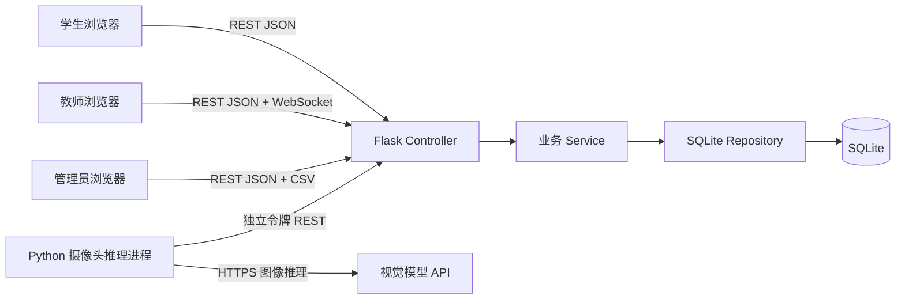
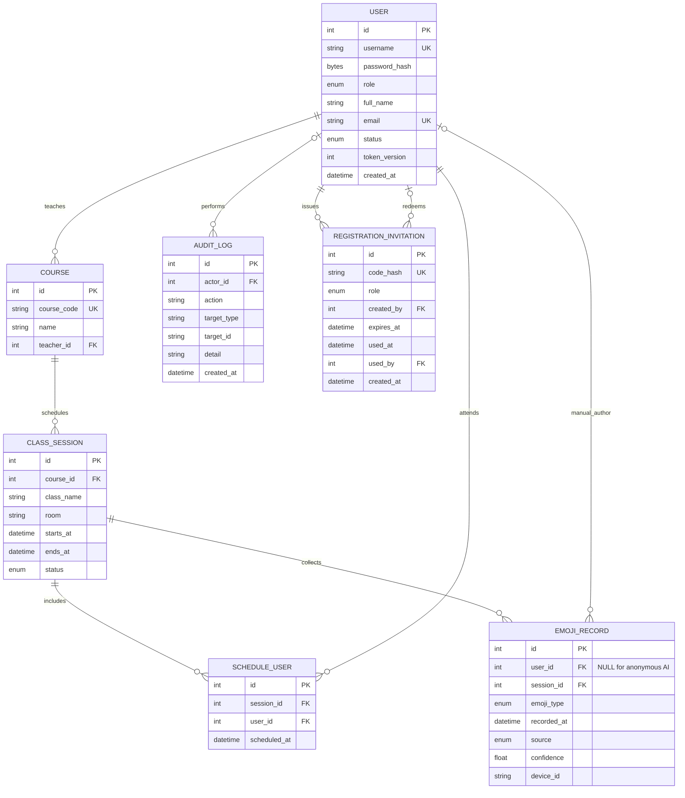

# 系统设计与数据模型

## 架构

浏览器使用原生 JavaScript 维护页面状态并通过统一 API Repository 调用后端，承担客户端 MVVM 中 View 与 ViewModel/Repository 的职责。后端按 Controller、Service、Repository 分层实现修改版 MVC。摄像头推理由独立 Python 进程承担，不与浏览器账号 JWT 混用服务令牌。

## ER 模型

核心约束位于 [database_setup.sql](../database_setup.sql)：`role`、`status`、情绪类型和记录来源使用 CHECK；人工记录必须关联用户且置信度为空，AI 记录必须匿名且置信度为 0-1；课堂时间段必须正向；排课表按课堂/用户唯一。AI 图片或视频不属于任何实体。

## 认证与权限

登录令牌为 HS256 JWT，包含用户 ID、用户名、角色、令牌版本和过期时间。每个受保护请求均重新读取用户状态；账号停用或令牌版本变化后拒绝访问。学生可公开注册；教师和管理员注册需要对应角色的一次性邀请码。管理员接口强制 admin；教师查询追加授课教师条件；学生历史查询固定当前 user ID。

邀请码由管理员通过 `POST /api/admin/invitations` 生成，使用 192 位随机数，SHA-256 哈希入库，有效期 1-168 小时。明文只在生成响应中返回且禁止缓存，日志不记录明文。注册使用 SQLite `BEGIN IMMEDIATE` 事务，账号写入与邀请码核销同时提交；重复用户名等失败不会消耗邀请码。

首次管理员初始化使用 `ADMIN_BOOTSTRAP_TOKEN`，仅在没有任何管理员且没有 `admin_bootstrap` 审计记录时允许。检查、创建账号、写入初始化标记处于同一个事务，阻止并发创建多个首任管理员；日后角色变更不会重开初始化入口。密钥不出现在客户端配置中，初始化状态接口只返回是否可用。

AI 入库接口只读取 `X-AI-Service-Token`，采用常量时间比较；低于 `AI_CONFIDENCE_THRESHOLD` 返回已丢弃结果，不创建记录。原始帧不会进入该 API。

## 数据流

### 学生手动反馈

登录 → 查询已安排课堂 → 服务端验证名单、课堂状态和时间 → 校验情绪枚举 → `EmojiRecord` 写入 SQLite → 教师 WebSocket 聚合刷新。

### AI 汇总反馈

摄像头进程内采样 → OpenCV 本地 Haar 人脸检测 → 裁剪最多 8 个脸部样本到内存拼图 → 视觉模型返回主导情绪和置信度 → 本地阈值预筛 → 独立令牌调用 AI 入库接口 → 服务端二次校验 → 写匿名 AI 记录。模型调用错误采用有限指数退避；完整视频帧和脸部拼图均不持久化。裁片仍属于可识别生物特征数据，且会发送至用户配置的外部模型 API。

### 管理员统计与实时看板

统计筛选器发送 `course_id`、`class_name`、`from`、`to`；后端统一转换为 UTC 后聚合为情绪分布、每日趋势、按课程和按班级的数量分组。前端将这些结果绘制为趋势图和对比条形图。实时看板独立选择课堂，总数、积极/专注比例、趋势及最新反馈统一取近60分钟；12个桶覆盖同一滑动窗口，排除未来记录。`/ws/dashboard` 每5秒推送，每次先复核JWT、状态、令牌版本、角色及归属，失败则关闭；前端回退至10秒HTTP轮询。历史分布与筛选总数独立保留。

## API 契约

完整机器可读契约见 [openapi.json](openapi.json)，浏览器访问 `/api/docs`。普通响应格式为 `{ "code": 200, "message": "ok", "data": ... }`。日期使用 ISO 8601；列表默认最多 100 项，可由 `limit` 调整至 500。

| 方法 | 路径 | 角色 |
| --- | --- | --- |
| GET | `/api/auth/registration-options` | 公开，仅返回初始化是否可用 |
| POST | `/api/auth/register` | 学生公开；教师/管理员验证邀请码或首次初始化密钥 |
| POST | `/api/admin/invitations` | 管理员，签发角色邀请码 |
| POST | `/api/auth/login` | 公开 |
| PUT | `/api/auth/password` | 登录用户 |
| GET | `/api/users/me` | 登录用户 |
| GET | `/api/sessions` | 登录用户，按角色过滤 |
| POST | `/api/emoji` | 学生 |
| GET | `/api/emoji/history`、`/api/emoji/statistics` | 登录用户，按角色过滤 |
| GET | `/api/admin/dashboard/realtime?sessionId=` | 该课教师/管理员 |
| WebSocket | `/ws/dashboard` | 首消息含 JWT 和 `session_id` |
| GET | `/api/admin/statistics` | 教师/管理员 |
| GET/POST | `/api/admin/courses`、`/api/admin/sessions` | 管理员 |
| GET/POST | `/api/admin/sessions/{id}/schedule` | 管理员 |
| GET/PUT | `/api/admin/users`、`/api/admin/users/{id}` | 管理员 |
| GET | `/api/admin/emoji/export?format=csv` | 管理员 |
| POST | `/api/ai/emoji-results` | AI 服务令牌 |

## 架构决策

系统采用 SQLite 保存业务数据，本地演示无需额外启动数据库服务；Repository 封装数据库访问，后续可根据并发需求迁移到 PostgreSQL。管理端与学生/教师端共用单页客户端，减少重复路由与接口。实时更新同时支持 WebSocket 和轮询，兼顾代理不支持升级的环境。
