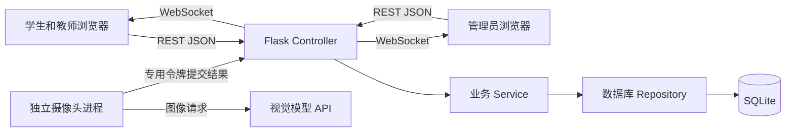

# 表情符号课堂情绪检查器系统实验报告

- 课程：软件工程实践
- 实验类型：综合设计性实验
- 记录日期：2026 年 11 月 11 日
- 项目仓库：[Emoji Classroom Emotion Checker](https://github.com/sds7788/Emoji_Classroom_Emotion_Checker)

本实验以已有的智能餐饮管理系统仓库为改造起点，围绕课堂反馈重新组织业务。学生可以选择表情记录当时的感受，教师查看自己所授课堂的数据，管理员负责开户、排课、统计和导出。系统还预留了摄像头情绪分析入口，由独立的 Python 进程调用视觉模型 API，再将结果提交给后端。

目前已完成浏览器端、后端和数据库的主要功能，本地账号、反馈、排课和看板流程可以运行。AI 采样与调用代码已经实现，但模型密钥尚未配置，真实摄像头到模型再到数据库的完整过程还没有实测。本报告中的 AI 测试结果只涉及已经验证的接口规则和无人脸帧处理，不包含模型识别准确率。

## 一 实验任务与实现范围

课堂反馈与一般的业务管理系统有一个明显区别：记录必须对应到某一次课。同一门课程在不同日期上课，参加的学生、课程进度和课堂感受都可能不同。因此，这次实验除了用户和情绪记录，还需要课程、课堂课次和学生名单三部分数据。

实验需要完成的主要流程是：管理员创建课程与课次、安排名单，学生在开放的课堂内提交表情，教师和管理员查看相应统计，管理员按条件导出记录。账号权限、数据库约束和接口校验也需要覆盖这些流程，不能只靠页面上是否显示按钮来控制访问。

客户端采用浏览器实现，没有另外制作 Android 应用。学生、教师和管理员共用一个 Web 入口，登录后按角色显示页面；AI 服务单独运行，通过专用令牌访问入库接口。这样可以先完成业务流程，再接入模型，不会因为暂时缺少模型凭据而影响手动反馈。

## 二 实验环境与技术选择

| 部分 | 使用的技术或环境 | 用途 |
| --- | --- | --- |
| 开发与验证环境 | Windows、Python 3.12 | 本地运行后端、测试和摄像头进程 |
| 浏览器界面 | HTML、CSS、原生 JavaScript | 登录、表情选择、排课、统计图表和记录展示 |
| 后端 | Flask、Flask-Sock | REST API、认证和 WebSocket 看板 |
| 数据库 | SQLite | 保存账号、课次、名单、情绪记录和审计日志 |
| 身份认证 | bcrypt、JWT | 密码哈希、登录凭证和角色校验 |
| AI 接入 | OpenCV、requests、兼容 OpenAI 接口的视觉模型 | 人脸检测、采样图处理和模型请求 |
| 测试 | unittest、Flask 测试客户端 | 使用独立临时数据库验证接口与业务规则 |

指导书给出了数据库和后端框架的建议，本项目选择 Flask 和 SQLite，主要考虑本地演示的安装成本。SQLite 不需要另外启动数据库服务，第一次运行时就可以建立表结构和演示数据。查询仍通过 Repository 封装，后续更换数据库时，可以集中修改存储部分。

这个选择也有限制。SQLite 适合当前的单机实验规模，多课堂同时写入时可能出现锁等待，不能凭本地测试就判断它能够承受全校并发使用。项目提供了 Dockerfile 和 Compose 配置，但本次没有完成容器构建验证。

## 三 业务调整与系统设计

### 3.1 将记录归属到具体课次

改造时，数据库围绕课堂重新建模。`courses` 表保存课程和授课教师；`class_sessions` 表保存某一次课的班级、教室、开始时间、结束时间和状态；`schedule_users` 表记录该次课安排了哪些学生。

情绪记录关联的是课次 ID。查询时再通过课次找到课程和班级，既可以查看一节课，也可以汇总同一课程或同一班级在一段时间内的数据。名单按课次保存，可以避免把“选过这门课程”直接等同于“能够向这次课堂提交反馈”。

### 3.2 角色与数据范围

学生可以直接注册，只能看到安排给自己的课堂和本人提交的记录。教师只能查询自己负责的课程与课堂，管理员可以维护全部课程、名单、账号和记录。后端根据当前登录用户附加查询条件，不使用前端传入的角色作为权限依据。

教师与管理员的注册使用邀请码。现有管理员选择身份和有效期后生成代码，数据库只保存代码的 SHA-256 哈希。代码必须与注册身份一致，且没有过期、没有使用过。重复用户名导致注册失败时，邀请码仍然可以继续使用。

新数据库没有管理员时，可以由部署者设置 `ADMIN_BOOTSTRAP_TOKEN`，用它完成首任管理员注册。创建账号与写入初始化标记放在同一个事务中，防止两个并发请求都通过“当前还没有管理员”的检查。初始化成功后，即使后来修改了管理员角色，也不会重新开放这个入口。

### 3.3 架构与职责划分



后端的分层分别落在 `backend/app.py`、`backend/services.py` 和 `backend/database.py` 中。Controller 处理路由、认证、参数和响应；Service 处理数据范围、统计、注册核销等规则；Repository 管理连接、建表和数据库访问。

前端的 HTML 负责页面结构，JavaScript 保存登录状态、处理交互和调用统一的 `api()` 方法，CSS 负责布局。这个划分承担了客户端 View、状态处理和 API 访问的职责。不过，学生、教师和管理端的逻辑仍集中在一个脚本里，管理端 Model 与 Controller 尚未拆成独立模块。当前规模下可以维护，功能继续增加时需要进一步拆分。

### 3.4 数据库结构与约束

| 数据表 | 主要内容 | 约束或关联 |
| --- | --- | --- |
| `users` | 用户名、密码哈希、角色、状态、令牌版本 | 用户名唯一，角色和状态有枚举约束 |
| `courses` | 课程编号、课程名称、教师 | 课程编号唯一，关联授课教师 |
| `class_sessions` | 课程、班级、教室、起止时间、状态 | 结束时间晚于开始时间 |
| `schedule_users` | 课次与学生名单 | 同一课次不能重复安排同一学生 |
| `emoji_records` | 表情、课次、时间、来源、置信度、设备标识 | 手动记录关联用户；AI 记录用户为空并保存置信度 |
| `registration_invitations` | 邀请码哈希、角色、有效期、使用状态 | 哈希唯一，关联签发人与使用者 |
| `audit_logs` | 操作者、操作类型、对象和时间 | 保存注册、角色维护、导出等操作记录 |

表结构由根目录的 `database_setup.sql` 幂等创建。外键、唯一约束和 `CHECK` 用来限制不合法数据，接口层再给出可读的错误提示。例如，AI 记录必须带有 0 到 1 之间的置信度，手动记录则不能混入 AI 置信度。数据库中没有保存人脸图片或视频的字段。

## 四 主要功能实现

### 4.1 学生反馈与个人历史

学生登录后，页面加载已安排的课堂。提交时，后端同时检查名单、课堂状态和当前时间；只有状态为 `active`，且当前时间在开课与结束时间之间，才允许写入。可选表情包括开心、困惑、无聊、低落、专注和兴奋，共六类。

手动记录保存当前学生 ID，来源记为 `MANUAL`。历史查询固定使用登录用户的 ID，因此修改请求参数不能取得其他学生的记录。修改密码时需要提供旧密码，成功后增加令牌版本，使原来的 JWT 失效。

### 4.2 教师看板与管理员统计

教师看板展示所选课堂近一小时的记录、情绪分布和五分钟分桶的变化趋势，历史统计可以按课程、班级和日期筛选。管理员除用户和排课管理外，还可以查看全局的每日趋势、课程反馈对比和班级反馈对比。

管理员页面把历史筛选和实时课堂选择分开。历史筛选改变统计范围，实时看板继续显示所选课堂近 60 分钟的数据。WebSocket 每 5 秒发送一次聚合结果；连接不可用时，前端使用 10 秒 HTTP 轮询。管理员历史统计也定期刷新。

这里的比例按记录条数计算。例如，“专注状态”表示专注记录占当前统计范围记录的比例，不是专注学生占全班的比例。一个学生可以在不同时刻提交反馈，AI 的一次结果也可能来自多个脸部样本，因此不能把记录数直接当作人数。

### 4.3 排课与导出

管理员先创建课程并指定教师，再创建课次、设置时间和状态，最后保存学生名单。新注册的学生不会自动出现在所有课堂中，必须经过排课才能提交反馈。

记录页支持按课堂、课程、班级、时间和来源查询，CSV 导出使用相同的筛选条件。文件以 UTF-8 BOM 输出，便于电子表格识别中文。对可能被解释成公式的文本单元格增加前缀，导出操作同时写入审计日志。目前单次导出最多 500 条，尚未实现大数据量分页导出。

### 4.4 AI 采样与结果入库

AI 进程先从摄像头读取帧，按配置间隔选取样本。OpenCV 在本地检测人脸，没有检测到人脸就丢弃该帧；检测到后，按人脸区域大小选取最多 8 个样本，裁剪并组成临时拼图，再发送给视觉模型。模型需要返回约定的情绪类型和置信度。

本地程序先进行一次阈值过滤，达标后通过 `/api/ai/emoji-results` 提交。后端使用 `X-AI-Service-Token` 校验调用者，重新检查情绪枚举、置信度和课堂是否开放。写入时来源为 `AI`，用户 ID 固定为空。人工账号的 JWT 不作为 AI 服务令牌使用。

采样间隔和置信度阈值都可以配置，默认分别为 5 秒和 0.55。请求失败时程序记录错误，并进行有限的指数退避。原始帧和临时拼图在内存中处理，当前代码没有将它们写入文件或数据库。

## 五 实验运行与验证结果

### 5.1 本地运行

在项目根目录安装普通服务依赖并启动后端：

```powershell
python -m pip install -r requirements.txt
$env:JWT_SECRET = "替换为独立随机签名密钥"
python -m backend.app
```

浏览器访问 `http://127.0.0.1:5000`。新数据库会生成管理员、教师和学生演示账号。数据库只在空库时生成样例，已有课次的时间不会因为重启而自动延后；如果示例课次已经结束，需要由管理员重新创建当前时间内的课堂并安排名单。

摄像头进程使用 `requirements-ai.txt` 中的可选依赖，并需要单独填写模型 API 地址、模型名、API Key 和服务令牌。本次没有填写真实模型凭据。测试和浏览器验收使用了独立临时数据库，避免将验收账号混入本地演示数据。

### 5.2 自动化测试

2026 年 11 月 11 日执行了以下命令：

```powershell
python -m unittest discover -s tests -v
```

共运行 11 个测试方法，全部通过。各项名称与详细结果见[测试报告](test-report.md)，代码位于 [tests/test_api.py](../tests/test_api.py)。主要检查内容如下。

| 检查内容 | 实际结果 |
| --- | --- |
| 学生登录、提交、个人历史和统计 | 提交后可查询到来源为 `MANUAL` 的对应记录 |
| 教师与学生的数据范围 | 教师访问其他教师课堂被拒绝，学生不能进入用户管理接口 |
| 排课与课堂访问 | 管理员保存学生名单后，该学生能够访问对应课堂 |
| 改密与旧令牌失效 | 修改密码后，旧 JWT 请求返回 401，新密码可登录 |
| 邀请码注册 | 错误身份、过期和重复使用被拒绝；重复用户名不会消耗邀请码 |
| 首任管理员初始化 | 两个并发请求只有一个成功，之后角色变更也不会重开初始化 |
| 统计筛选与时间边界 | 课程、班级与时间组合筛选正确，其他教师看不到分组数据 |
| AI 入库与 CSV 处理 | 无效令牌被拒绝，低置信度结果不入库，公式开头的导出文本被转义 |
| 无人脸帧处理 | 空白帧返回无人脸结果，没有向外部模型发送请求 |
| 健康检查与接口文档 | 健康接口及 OpenAPI JSON 可以访问 |

AI 入库测试将阈值设置为 0.60，置信度 0.59 的结果被丢弃，0.91 的结果成功保存，且没有关联学生账号。这验证了令牌、阈值和入库约束，不代表已经验证了模型对图像的判断。

### 5.3 浏览器验收

页面验收分别使用带演示数据的临时服务和关闭演示数据的空库服务。先由管理员生成教师和管理员邀请码，受邀人注册后均进入对应角色页面；新教师尚未分配课程时，页面显示空状态。空库使用初始化密钥建立首任管理员后，重新进入注册页已不再显示初始化提示。

统计验收中，选择示例课程、班级及前一天日期，反馈总数为 1，情绪分布和课程、班级对比也都对应这 1 条记录。随后学生提交一次专注反馈，管理员实时记录数由 7 增加到 8，最新记录出现该次反馈，而前一天的历史统计仍为 1。这个结果说明两组数据的范围没有互相覆盖。

另外检查了未来日期、未选择实时课堂和 390px 窄屏页面。无记录时能够显示提示，窄屏下筛选项可以换行，没有页面横向溢出。验收页面未记录浏览器警告或 JavaScript 错误。[管理员端截图](screenshots/admin-dashboard.png)保留了统计图表和实时看板的运行状态。

### 5.4 已验证结果的范围

现有自动化测试主要通过 Flask 测试客户端验证接口和集成规则，浏览器操作用于补充页面检查。它们还不能代替独立的 Service 单元测试、SQL 注入与弱密码专项测试，也没有形成完整的跨角色自动化 E2E 脚本。摄像头成功识别人脸后，经模型响应再入库的完整测试尚未完成。

因此，当前可以确认的是主要手动业务和接口规则可运行。真实 AI 推理、容器构建、大规模并发及不同浏览器的兼容性，仍需在相应环境中继续验证。

## 六 实现中处理的几个问题

### 6.1 时间筛选边界

浏览器日期筛选按本地一天的开始和结束生成时间，数据库记录使用 UTC。如果直接比较不同格式的时间字符串，恰好位于边界上的记录可能被漏掉。后端现在先把筛选时间转换为统一的 UTC 格式，再查询记录，并拒绝开始时间晚于结束时间的条件。测试使用同一时刻的不同时间区表示检查了边界。

### 6.2 实时数据覆盖历史统计

实时看板的范围是近一小时，历史分布则由筛选条件决定。两者如果使用同一个更新函数，WebSocket 消息到达后就可能把历史分布改成实时分布。当前将两部分的绘制分开，实时消息只更新实时指标、趋势和最新记录。浏览器验收中，新增反馈后历史统计保持不变，也检查了这一点。

### 6.3 邀请码的核销时机

邀请码不能在检查通过后立即单独标记为已使用，因为后面的账号创建仍可能因用户名重复而失败。当前注册使用一个数据库事务完成账号插入、邀请码核销和审计记录，任何一步失败都回滚。首任管理员初始化也采用相同思路，使检查和写入之间不会被另一个请求插入。

### 6.4 导出文件的内容安全

用户姓名等文本可以进入 CSV，仅对 SQL 做参数化处理还不够。例如姓名以 `=` 开头时，电子表格可能将其作为公式执行。当前导出会转义这类文本，测试中使用 `=1+1` 作为姓名检查了输出结果。这个问题说明，输入进入不同位置时，需要分别考虑数据库、页面和导出文件的解释规则。

## 七 AI 局限性分析

### 7.1 表情与课堂理解之间没有直接对应关系

学生皱眉可能是在思考，也可能是看不清屏幕；低头可能是在记笔记。即使表情分类正确，也不能据此认定学生已经理解或没有理解课程。系统中的“专注”“困惑”等标签只能作为反馈选项和观察线索，不能当成对个人学习能力的结论。

### 7.2 模型置信度尚未经过校准

接口返回的置信度是模型给出的数值，本项目没有用带标注的课堂样本验证它与实际正确率的关系。将阈值设为 0.60，只能说明程序会过滤低于这个值的结果，不能解释成剩余结果至少有 60% 的正确率。目前也没有样本量、准确率、召回率或混淆矩阵，不能给出识别效果的定量结论。

### 7.3 采样方式会影响统计

当前人脸检测使用 OpenCV Haar 方法，对正面、较清晰的人脸更容易检测到。距离较远、遮挡或侧脸可能被漏掉，按区域大小选取最多 8 个样本也会偏向镜头附近的人。模型对拼图只返回一个主导情绪，少数人的不同感受可能没有体现出来。

采样记录还会重复观察同一批人。因此，AI 结果表示某次采样的汇总判断，既不是逐个学生的情绪档案，也不是独立参与人数。人工反馈与 AI 结果可以按来源查询，解释统计时应保留这个区别。

### 7.4 外部模型的速度与可用性存在限制

默认采样间隔为 5 秒，但模型调用是同步的。如果一次网络请求耗时超过 5 秒，实际处理速度就会受请求耗时限制，不能保证每 5 秒都有新的预测。网络中断、接口限额和返回格式变化也可能导致采样结果丢弃。

代码中已有超时、日志和退避处理，尚未对课堂网络环境中的延迟、调用费用或长时间稳定性做测量。后续需要先记录请求耗时和失败原因，再决定是否增加队列或更换本地模型。

### 7.5 不关联账号不等于图像已经匿名

AI 结果入库时没有学生 ID，原始帧和拼图也不落盘，但发给模型的脸部裁片仍可能识别个人。当前设计减少了本地保存的图像数据，没有消除向外部服务发送图像的隐私问题。实际使用前应说明用途、征得必要授权，并核对模型提供方的数据保留设置。

AI 模块应作为可选功能使用。学生主动反馈仍是独立入口，模型不可用时不影响手动记录；统计也不应直接用于成绩、纪律或其他针对个人的重要判断。

## 八 不足与后续改进

当前系统完成了账号、课次、名单、反馈、统计和导出的基本业务，但距离实际课堂长期使用还有差距。后续首先需要补齐 AI 成功链路的集成测试和真实环境验证，再记录模型输出、教师观察与学生主动反馈之间的差异，确认结果是否有实际参考价值。

测试方面，需要将部分业务规则抽成独立单元测试，补上 SQL 注入、弱口令和完整跨角色 E2E 用例。现有密码校验主要限制长度，尚未加入常见弱口令检查。页面验收也需要扩展到其他浏览器，并验证连接中断、恢复和连续使用的情况。

工程方面，前端脚本可以按角色和职责拆分，CSV 导出需要处理超过 500 条的情况。数据库是否迁移到 PostgreSQL 或 MySQL，应结合并发测试结果决定。Docker 配置还需实际构建运行，不能只依据配置文件存在就认为部署验证完成。

## 九 实验总结

本次改造使原仓库转向了以课堂课次为中心的业务。系统已经可以由管理员安排课堂，学生提交表情，教师和管理员查看相应数据，并将筛选结果导出。教师、管理员的受控开户也已经补齐，避免了仅依赖演示账号的情况。

实验中需要反复核对的是各处规则是否一致：名单决定学生能否进入课堂，角色决定能查哪些数据，时间决定能否提交和落入哪个统计范围，来源则决定一条记录能够怎样解释。这些规则分别落实在页面、接口和数据库中，才能使演示结果具有可重复性。

目前最需要继续完成的是 AI 的实测和测试覆盖。手动业务的通过结果已经有测试与页面记录支撑，AI 部分仍应按实际完成程度说明，后续补充模型与摄像头实验后再更新报告结论。

## 相关材料

- [需求规格说明书](requirements.md)
- [系统设计与 ER 模型](design.md)
- [OpenAPI 接口定义](openapi.json)
- [测试报告](test-report.md)
- [部署说明](deployment.md)
- [用户手册](user-guide.md)
- [现场演示流程](demo-script.md)
