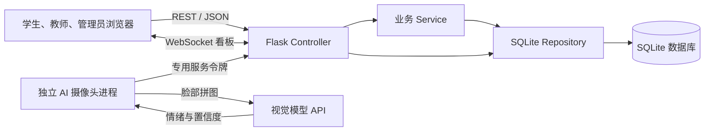
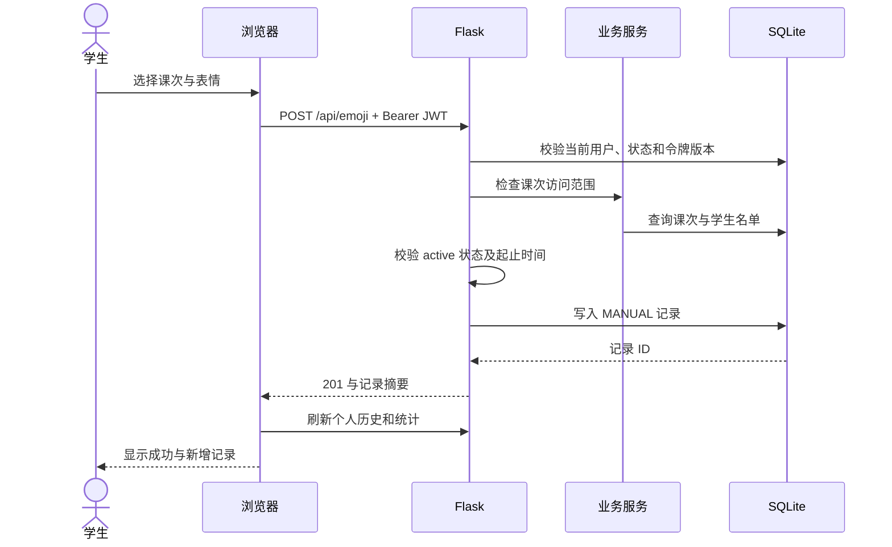
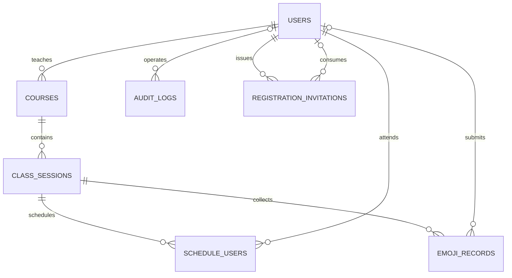
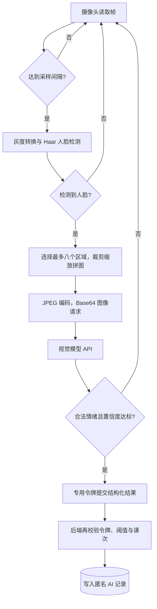

# 表情符号课堂情绪检查器系统实验报告

| 项目 | 内容 |
| --- | --- |
| 课程 | 软件工程实践 |
| 实验类型 | 综合设计性实验 |
| 系统名称 | 表情符号课堂情绪检查器系统 |
| 报告日期 | 2026 年 11 月 11 日 |
| 客户端 | 浏览器 Web 客户端 |
| 项目仓库 | [Emoji Classroom Emotion Checker](https://github.com/sds7788/Emoji_Classroom_Emotion_Checker) |

## 摘要

本实验实现了一套面向课堂教学的情绪反馈系统。学生在已安排的课堂内选择表情，教师查看自己课程的反馈，管理员完成账号管理、课程创建、课次安排、学生名单维护、多维统计和记录导出。系统以“具体某一次课”为记录归属单位，将课程、班级、时间和反馈来源联系起来，避免不同课堂的数据混在一起。

客户端使用 HTML、CSS 和原生 JavaScript；后端使用 Flask，按接口控制、业务处理和数据访问划分职责；SQLite 保存业务数据；JWT、bcrypt 和角色校验共同完成账号认证与权限控制。实时看板采用 WebSocket，连接失败时回退到 HTTP 轮询。可选 AI 进程使用 OpenCV 对摄像头采样帧检测人脸、裁剪拼图，再调用支持图像输入的模型 API，将通过置信度检查的结果提交给后端。

当前51项自动化测试全部通过，20个浏览器验收场景通过（原三角色9项及网页AI11项），证据保存在docs/evidence。已修复教师指标口径和WebSocket持续授权，补测Service、SQL注入、弱密码、CSV及模拟模型成功链路；AI增加单次采样和脱敏JSONL。本轮自动化未使用真实摄像头或外部模型，不能把模拟结果等同于用户电脑的真实推理验收。视频尚未录制，目标电脑与Docker仍待现场验证，最终压缩包按用户要求暂缓。本报告不提供未经测量的准确率、并发量或模型响应性能。

关键词：课堂反馈；角色权限；Flask；SQLite；WebSocket；视觉模型 API

## 目录

1. [实验目的与任务分析](#一实验目的与任务分析)
2. [需求分析与用例设计](#二需求分析与用例设计)
3. [实验环境、依赖与技术选择](#三实验环境依赖与技术选择)
4. [总体架构与模块设计](#四总体架构与模块设计)
5. [数据库设计与数据一致性](#五数据库设计与数据一致性)
6. [后端与接口实现](#六后端与接口实现)
7. [前端页面与交互实现](#七前端页面与交互实现)
8. [查询、统计与实时图表](#八查询统计与实时图表)
9. [AI 摄像头模块与模型 API](#九ai-摄像头模块与模型-api)
10. [安全、隐私与数据边界](#十安全隐私与数据边界)
11. [配置、运行与部署](#十一配置运行与部署)
12. [测试设计、执行与结果](#十二测试设计执行与结果)
13. [实现问题、处理办法与取舍](#十三实现问题处理办法与取舍)
14. [AI 局限性与结果解释](#十四ai-局限性与结果解释)
15. [材料组织与后续完善](#十五材料组织与后续完善)
16. [实验总结](#十六实验总结)

## 一、实验目的与任务分析

### 1.1 实验目的

本实验需要完成一个可以实际操作的多角色系统，并把需求、数据模型、接口、页面、测试和部署说明对应起来。具体目标包括：

1. 将课堂反馈需求分解为可验收的用例，明确学生、教师、管理员和 AI 服务各自的权限。
2. 按 MVC 思路组织客户端与后端，划分数据库访问、权限判断和界面展示的职责。
3. 使用关系数据库表达课程、课次、名单和记录的关联，落实唯一性、外键和数据约束。
4. 完成注册登录、密码修改、课堂反馈、历史查询、统计图表、实时看板和 CSV 导出。
5. 接入可配置的 AI 服务入口，使缺少模型密钥时普通功能仍能独立运行。
6. 通过自动化测试和页面验收检查业务规则，分析 AI 输出的适用范围与误判风险。

### 1.2 业务场景与核心对象

学生在课堂上不一定会主动举手表达困惑。表情反馈提供了一个较轻的入口，教师可以观察一段时间内的变化，再决定是否放慢讲解或补充例子。管理员则需要知道某门课、某个班级在指定时间内产生了哪些记录，并保证学生只能进入安排给自己的课堂。

这里需要区分三个对象。“课程”表示教学科目和授课教师；“课堂课次”表示某一天、某个班级、某个时间段的一次授课；“情绪记录”表示在该课次内提交的一次反馈。同一个学生可以多次提交，一门课程也可以有多个课次。因此，记录数量不能直接解释为学生人数。

AI 部分提供的是采样时刻的汇总结果，当前不识别学生身份，也不建立个人面部档案。它和学生主动提交的表情使用同一套情绪枚举，但保留不同的来源标记，查询时可以分开观察。

### 1.3 实现范围与完成状态

| 范围 | 当前状态 | 说明 |
| --- | --- | --- |
| 三类用户注册、登录、改密 | 已实现并验证 | 教师和管理员使用角色邀请码；空库支持首任管理员初始化 |
| 课程、课次和学生名单 | 已实现并验证 | 支持创建与查询、按课次替换名单 |
| 学生手动反馈与个人历史 | 已实现并验证 | 六类表情，受名单、状态和时间约束 |
| 教师历史统计与实时看板 | 已实现并验证 | 限本人所授课程，包含分布、趋势和最新记录 |
| 管理员多维统计、实时看板、导出 | 已实现并验证 | 课程、班级、日期筛选，CSV 最多导出 500 条 |
| AI 采样、模型调用、过滤和入库 | 已实现，模拟链路通过 | 受控模型响应→实际裁剪编码→后端→数据库/统计/导出已验证，真实模型/摄像头待实测 |
| Docker 部署文件 | 已提供 | 未完成实际构建与容器运行验收 |
| Android、消息队列、MCP 封装、CI | 未纳入本次实现 | 客户端使用浏览器，AI 进程直接调用 API |

## 二、需求分析与用例设计

### 2.1 角色与操作权限

| 操作 | 学生 | 教师 | 管理员 | AI 服务 |
| --- | --- | --- | --- | --- |
| 注册 | 公开注册 | 凭教师邀请码 | 凭管理员邀请码或空库初始化密钥 | 不使用账号注册 |
| 登录、修改本人密码 | 可以 | 可以 | 可以 | 使用独立服务令牌 |
| 查看课堂列表 | 本人名单中的课堂 | 本人所授课堂 | 全部课堂 | 无查询权限 |
| 手动提交表情 | 开放课堂内可以 | 不可以 | 不可以 | 不可以 |
| 查看记录与统计 | 本人手动记录 | 本人所授课程 | 全部数据 | 不可以 |
| 实时看板 | 不可以 | 本人所授课堂 | 任意课堂 | 不可以 |
| 管理账号、签发邀请码 | 不可以 | 不可以 | 可以 | 不可以 |
| 创建课程、课次和维护名单 | 不可以 | 不可以 | 可以 | 不可以 |
| CSV 导出 | 不可以 | 不可以 | 可以 | 不可以 |
| 提交 AI 结果 | 不可以 | 不可以 | 普通 JWT 不具备该权限 | 专用令牌校验后可以 |

页面按角色隐藏无关入口，后端仍会独立检查。学生即使自行构造用户管理请求，也会被接口拒绝；教师查询统计时，业务层会追加当前教师 ID，不能仅靠改课程参数获得其他教师的数据。

### 2.2 功能需求与实现对应

| 编号 | 功能需求 | 实现位置与验收依据 |
| --- | --- | --- |
| FR-01 | 用户注册、登录，密码哈希保存 | 认证接口、users 表、登录与注册测试 |
| FR-02 | 修改密码并使旧令牌失效 | token_version、改密接口与旧 JWT 测试 |
| FR-03 | 学生查看已安排课堂 | schedule_users、课堂列表的名单查询 |
| FR-04 | 开放课堂内提交六类情绪 | 手动记录接口、枚举和课堂时间检查 |
| FR-05 | 学生查询个人历史 | 查询固定当前用户 ID，不接受越权身份选择 |
| FR-06 | 教师查看所授课堂历史和统计 | 教师数据范围、历史分布和实时趋势 |
| FR-07 | 管理员调整用户角色和状态 | 用户管理页面与管理员接口 |
| FR-08 | 创建课程、课次并维护名单 | 排课页面、名单事务与排课测试 |
| FR-09 | 条件查询和 CSV 导出 | 统一筛选、BOM、公式前缀处理、审计 |
| FR-10 | AI 专用令牌与置信度过滤 | 错误令牌和阈值测试 |
| FR-11 | AI 结果不关联学生账号 | 入库强制 user_id=NULL，来源约束 |
| FR-12 | 教师实时观察课堂变化 | WebSocket 五秒推送、HTTP 十秒回退 |
| FR-13 | REST/JSON 与接口说明 | 统一响应、OpenAPI、Swagger UI |
| FR-14 | 教师、管理员安全开户 | 角色邀请码、核销事务和首任初始化 |
| FR-15 | 管理员多维图表与实时看板 | 历史筛选与独立实时课堂选择 |

### 2.3 典型用例

#### 用例一：学生提交课堂反馈

前置条件是学生账号处于启用状态，已登录，并被安排到一个当前开放的课次。正常流程为：加载课堂列表，选择课堂，点击表情，后端检查权限和时间后写入记录，页面刷新近期历史与个人统计。

异常情况包括：登录过期返回 401；未在名单中返回 403；表情类型非法返回 400；课堂未开始、已结束或状态不是 active 返回 409。按钮状态用于提示，最终是否允许提交由服务器决定。系统允许同一学生在一节课中多次反馈，当前未设置每分钟提交次数上限。

#### 用例二：教师查看课堂变化

教师登录后只能取得本人课程的课次列表，选择一个课堂后先通过 HTTP 加载最近一小时数据，再建立 WebSocket 订阅。历史部分可以按课程、班级和日期查询。切换课堂时关闭旧连接，防止旧课堂的数据继续更新当前页面。

没有课程时显示空状态；订阅无权访问的课堂会被拒绝；连接断开后使用定时查询继续更新。实时数据与历史筛选分开，不能用一次近一小时推送覆盖已选择的历史日期分布。

#### 用例三：管理员安排一次课

管理员选择教师创建课程，填写班级、教室、起止时间和课次状态，再勾选启用的学生保存名单。名单采用整体替换语义，保存的是“该课次最终包含哪些学生”。重复 ID 会去重，空列表表示清空名单，包含教师、停用用户或不存在用户时拒绝保存。

课次结束时间必须晚于开始时间。当前没有课程或课次的编辑、删除接口，也没有自动改变课次状态的定时任务，因此创建时需要核对信息；即使状态仍显示 active，超过结束时间后也不能继续提交。

#### 用例四：教师或管理员开户

现有管理员生成对应角色的一次性邀请码，受邀人在注册页选择同一角色并填写代码。服务器验证角色、有效期和使用状态，在一个事务内创建账号、核销代码并写入审计。用户名重复时事务回滚，代码不会被提前消耗。

没有管理员的新数据库由部署者设置初始化密钥，首任管理员使用该密钥注册。成功后写入持久审计标记；后续即使管理员角色发生变化，也不能重新使用初始化通道。

#### 用例五：AI 结果提交

独立进程按课次 ID 采样，先检测人脸，再调用模型。无脸、不支持的情绪或低置信度结果直接丢弃；通过本地检查后提交情绪、置信度和设备标识。后端再次验证服务令牌和课堂开放条件，写入一条不关联账号的 AI 记录。网络失败记日志并退避，不影响学生手动操作。

### 2.4 非功能需求

安全方面要求密码不明文保存、服务端控制权限、SQL 参数化、重要管理操作可追踪。可靠性方面要求名单更新和邀请码核销保持事务一致性，AI 不可用时手动功能仍可运行。可用性方面要求表情具有文字名称，错误可读，空数据有提示，窄屏可以完成主要操作。

性能目标限于单机实验场景：通过索引、聚合和定时刷新减少无关查询。当前没有负载测试数据，不能声称系统已满足大规模教学部署要求。

## 三、实验环境、依赖与技术选择

### 3.1 环境与第三方依赖

早期记录使用Windows/Python3.12；本轮在WSL2新建虚拟环境，使用Python3.13.11和Chromium158.0.8127.18复验。依赖采用版本范围，具体安装版本可通过pip freeze查询，以下声明不代表锁定版本。

| 技术或依赖 | 声明版本 | 实际用途 |
| --- | --- | --- |
| Python | 项目建议3.10+，本轮3.13.11 | 服务器、数据库访问、AI进程、测试 |
| Flask | >=3.0,<4.0 | 应用工厂、REST 路由、请求响应和静态文件 |
| Flask-Cors | >=4.0,<6.0 | 控制 /api/* 的跨域来源 |
| Flask-Sock | >=0.7,<1.0 | 课堂实时看板 WebSocket |
| PyJWT | >=2.8,<3.0 | HS256 签发、校验 JWT 和过期时间 |
| bcrypt | >=4.1,<5.0 | 密码加盐哈希与验证 |
| requests | >=2.31,<3.0 | 视觉模型请求、AI 结果提交 |
| python-dotenv | >=1.0,<2.0 | 两个服务自动读取根目录.env，终端变量优先 |
| Playwright / websocket-client | 开发验收依赖 | 三角色浏览器流程及真实长连接撤权验证 |
| opencv-python | >=4.9,<5.0，可选 | 摄像头、Haar 检测、裁剪、缩放和 JPEG 编码 |
| NumPy | 由 OpenCV 依赖引入 | 建立脸部拼图像素数组 |
| SQLite / sqlite3 | Python 运行时提供 | 关系存储、事务、约束和聚合 |
| HTML / CSS / JavaScript | 浏览器原生能力 | 多角色页面、表单、状态和交互 |
| Canvas 2D | 浏览器原生能力 | 每日趋势与五分钟趋势绘制 |
| Docker / Compose | 提供配置，未实测 | 普通 Web 服务与持久化数据卷 |

requirements.txt 包含普通服务依赖，requirements-ai.txt 在其基础上增加 OpenCV。普通服务启动时不会打开摄像头，也不会因为缺少模型密钥而失败。

### 3.2 标准库与浏览器接口

| 分类 | 使用内容 | 作用 |
| --- | --- | --- |
| 数据访问与资源管理 | sqlite3、contextlib、pathlib | 连接上下文、提交回滚、路径与建库 |
| 时间处理 | datetime、timezone、time.monotonic | UTC 存储、区间比较、采样间隔 |
| 编码与文件格式 | json、csv、io、base64 | API、CSV 和图像请求编码 |
| 随机与摘要 | secrets、hashlib、hmac | 邀请码、SHA-256、常量时间比较 |
| 运行与测试 | argparse、logging、unittest、tempfile、mock | 参数、日志、临时库和外部请求断言 |
| 浏览器请求 | Fetch、Headers、URLSearchParams | API 访问、认证头和查询参数编码 |
| 浏览器状态 | localStorage、DOM 事件 | 登录状态和页面交互 |
| 浏览器实时通信 | WebSocket、定时器 | 订阅推送和断线轮询 |
| 展示与下载 | Canvas、Intl.DateTimeFormat、Blob、URL | 图表、本地时间、CSV 下载 |

### 3.3 选择理由与代价

Flask 的路由和测试客户端适合本次实验，接口层可以保持较直接的结构。SQLite 不需要另装数据库服务，便于下载项目后运行，同时支持事务、外键和聚合。代价是写入并发和多实例部署能力有限，不能把单机文件数据库按服务器数据库的方式使用。

前端使用原生技术，避免额外的包管理和构建步骤，打开服务地址即可使用。图表由 Canvas 实现，当前数据量较小，可以控制样式和空状态；代价是坐标、缩放、折线和刷新都需要自己处理，也没有成熟图表库的悬浮提示与缩放功能。本项目未使用 Vue、React、Chart.js 或前端 npm 构建。

AI 使用 API 调用，没有训练本地情绪分类模型。这减少了模型部署工作，但识别效果、网络延迟、费用和图像数据处理方式都受模型服务影响。系统保留地址、模型名、密钥和阈值配置，便于调整兼容服务。

## 四、总体架构与模块设计

### 4.1 部署与调用关系



普通客户端与后端默认同源，Flask 同时提供静态页面和 API。AI 进程独立运行，摄像头只在该进程中打开。模型服务不直接连接数据库，只有经过后端校验的结构化结果才允许入库。

### 4.2 MVC 与分层对应

| 职责 | 对应文件 | 主要内容 |
| --- | --- | --- |
| View | frontend/index.html、style.css | 页面、表单、表格、图表容器和布局 |
| 客户端状态与事件处理 | frontend/script.js | 登录状态、角色导航、提交、渲染、实时连接 |
| Controller | backend/app.py | 路由、认证装饰器、参数检查、HTTP 响应 |
| Service | backend/services.py | 数据范围、筛选、统计、邀请码与名单规则 |
| Repository | backend/database.py | 连接、建表、基础查询、用户访问、演示数据和审计 |
| 数据模型 | database_setup.sql | 实体、关系、字段约束和索引 |
| 外部服务适配 | backend/ai_service.py | 摄像头、预处理、模型请求和结果提交 |

这里采用按职责组织的 MVC 思路，没有使用 ORM 实体类。部分简单插入和查询仍由 Controller 通过 Repository 执行，前端也仍是一个脚本文件，因此不能称为完全隔离的领域模型或组件框架。继续扩展时，可先拆分前端 API、状态和各角色页面，再集中后端写入规则。

### 4.3 项目文件组织

```text
backend/
  app.py                 应用工厂、认证、REST 与 WebSocket
  services.py            注册事务、数据范围、名单、历史和统计
  database.py            Repository、初始化和演示数据
  ai_service.py          可选摄像头推理进程
frontend/
  index.html             三类角色共用的单页入口
  script.js              API 封装、交互、状态和图表
  style.css              桌面与窄屏样式
tests/
  test_api.py             11个原有API集成测试
  test_services.py        5个业务规则测试
  test_security.py        5个安全专项测试
  test_realtime.py        5个订阅授权测试
  test_ai.py              10个模型解析、模拟链路及采样进程测试
  test_config.py          1个配置优先级测试
docs/                    需求、设计、接口、测试和使用材料
database_setup.sql       七张业务表与四个显式查询索引
requirements.txt         普通服务依赖
requirements-ai.txt      AI 可选依赖
.env.example             配置示例，不包含真实模型密钥
Dockerfile               普通服务容器定义
docker-compose.yml       单服务、端口和数据卷配置
```

### 4.4 一次反馈的调用过程



看板下一次刷新时重新聚合数据库。当前没有写入后发送消息的队列机制，WebSocket 每隔五秒查询并推送，所以“实时”表示定时更新，而非零延迟事件广播。

## 五、数据库设计与数据一致性

### 5.1 实体关系



USERS 包含三种角色。授课和参加名单的角色条件由业务层检查，外键只检查用户是否存在。记录的用户关联可为空，用于表达 AI 汇总；手动记录必须有用户的要求由额外 CHECK 保证。

### 5.2 用户表 users

| 字段 | 类型 | 空值、默认或约束 | 含义 |
| --- | --- | --- | --- |
| id | INTEGER | 自增主键 | 用户 ID |
| username | TEXT | 非空、唯一 | 登录账号 |
| password_hash | BLOB | 非空 | bcrypt 哈希 |
| role | TEXT | 非空，student/teacher/admin | 当前角色 |
| full_name | TEXT | 非空 | 显示姓名 |
| email | TEXT | 可空、唯一 | 可选邮箱 |
| status | TEXT | 非空，默认 active；active/disabled | 账号状态 |
| token_version | INTEGER | 非空，默认 0 | 令牌失效依据 |
| created_at | TEXT | 非空 | 注册时间 |
| last_login | TEXT | 可空 | 最近登录时间 |

用户名长度和邮箱格式由注册接口检查。空邮箱转成 NULL，允许多个用户不填邮箱；填写时转为小写后检查唯一性。对外用户查询不返回密码哈希。

### 5.3 课程表 courses

| 字段 | 类型 | 约束 | 含义 |
| --- | --- | --- | --- |
| id | INTEGER | 自增主键 | 课程 ID |
| course_code | TEXT | 非空、唯一 | 课程编号 |
| name | TEXT | 非空 | 课程名称 |
| teacher_id | INTEGER | 非空，外键 users，RESTRICT | 授课教师 |
| created_at | TEXT | 非空 | 创建时间 |

接口要求 teacher_id 对应教师角色。当前没有额外禁止为停用教师创建课程的检查，后续可补强状态规则。

### 5.4 课次表 class_sessions

| 字段 | 类型 | 约束 | 含义 |
| --- | --- | --- | --- |
| id | INTEGER | 自增主键 | 某一次课的 ID |
| course_id | INTEGER | 非空，外键 courses，CASCADE | 所属课程 |
| class_name | TEXT | 非空 | 班级名称 |
| room | TEXT | 非空，默认空字符串 | 教室 |
| starts_at | TEXT | 非空 | 开始时间 |
| ends_at | TEXT | 非空 | 结束时间 |
| status | TEXT | 非空，默认 scheduled | scheduled/active/ended |
| created_at | TEXT | 非空 | 创建时间 |

表级约束要求 ends_at > starts_at，接口先统一为 UTC 再比较保存。只有 active 且当前时间处于闭区间 [starts_at, ends_at] 内才开放记录。

### 5.5 课次名单表 schedule_users

| 字段 | 类型 | 约束 | 含义 |
| --- | --- | --- | --- |
| id | INTEGER | 自增主键 | 名单项 ID |
| session_id | INTEGER | 非空，外键 class_sessions，CASCADE | 课次 |
| user_id | INTEGER | 非空，外键 users，CASCADE | 学生 |
| scheduled_at | TEXT | 非空 | 安排时间 |

UNIQUE(session_id, user_id) 防止重复安排。班级名称用于筛选和展示，真正的访问依据是课次名单，不能用姓名或班级文字代替关联表。

### 5.6 情绪记录表 emoji_records

| 字段 | 类型 | 约束 | 含义 |
| --- | --- | --- | --- |
| id | INTEGER | 自增主键 | 记录 ID |
| user_id | INTEGER | 可空，外键 users，SET NULL | 手动提交者；AI 为空 |
| session_id | INTEGER | 非空，外键 class_sessions，CASCADE | 所属课次 |
| emoji_type | TEXT | 非空，六类枚举 | 情绪编码 |
| recorded_at | TEXT | 非空 | 记录时间 |
| source | TEXT | 非空，MANUAL/AI | 数据来源 |
| confidence | REAL | 可空，受来源约束 | AI 置信度 |
| device_id | TEXT | 可空 | web 或摄像头标识 |

联合约束为：手动记录必须有用户且置信度为空；AI 记录必须没有用户且置信度处于 0～1。接口也执行同样的来源规则。数据库没有图片、视频或人脸特征字段。

用户外键虽然声明 SET NULL，手动记录的用户非空约束仍会影响物理删除，因此不能据此宣称已经支持删除用户。本项目提供停用功能，没有用户删除接口。

### 5.7 审计表 audit_logs

| 字段 | 类型 | 约束 | 含义 |
| --- | --- | --- | --- |
| id | INTEGER | 自增主键 | 日志 ID |
| actor_id | INTEGER | 可空，外键 users，SET NULL | 操作者 |
| action | TEXT | 非空 | login、register、export_csv 等动作 |
| target_type | TEXT | 非空 | user、course、session 等对象类型 |
| target_id | TEXT | 可空 | 对象编号 |
| detail | TEXT | 非空，默认空字符串 | 角色、导出行数等摘要 |
| created_at | TEXT | 非空 | 操作时间 |

审计覆盖登录、注册、改密、用户调整、课程与课次创建、名单保存、邀请码签发和导出。admin_bootstrap 同时充当初始化永久关闭标记。日志不写入邀请码明文、密码或模型密钥；当前没有专门的审计查询页面和日志轮转任务。

### 5.8 邀请码表 registration_invitations

| 字段 | 类型 | 约束 | 含义 |
| --- | --- | --- | --- |
| id | INTEGER | 自增主键 | 邀请记录 ID |
| code_hash | TEXT | 非空、唯一 | 邀请码 SHA-256 摘要 |
| role | TEXT | 非空，teacher/admin | 允许注册角色 |
| created_by | INTEGER | 非空，外键 users | 签发管理员 |
| expires_at | TEXT | 非空 | 到期时间 |
| used_at | TEXT | 可空 | 核销时间 |
| used_by | INTEGER | 可空，外键 users | 使用者 |
| created_at | TEXT | 非空 | 签发时间 |

核销条件同时包含摘要匹配、角色匹配、used_at IS NULL 和尚未过期。高权限注册不会只根据客户端传入的 role 创建账号。

### 5.9 索引与查询组织

除主键和唯一约束形成的索引外，Schema 显式创建四个索引：

| 索引 | 字段 | 对应查询 |
| --- | --- | --- |
| idx_records_session_time | session_id, recorded_at DESC | 课次历史、最近一小时 |
| idx_records_user_time | user_id, recorded_at DESC | 学生个人历史 |
| idx_sessions_course_time | course_id, starts_at DESC | 按课程查看课次 |
| idx_schedules_user | user_id, session_id | 学生可见课次与名单判定 |

历史通过记录、课次、课程连接取得名称；用户使用左连接，使 AI 记录仍可显示为“匿名 AI 汇总”。结果按记录时间倒序、ID 倒序排列，默认 100 条，上限 500 条。统计聚合符合条件的全部记录，不受历史列表 500 条限制。

### 5.10 连接、事务与时间表示

Repository 每次操作建立连接，启用外键，连接超时和 busy_timeout 均为 10 秒。上下文正常退出时提交，异常时回滚，最后关闭。当前没有连接池，也没有启用 WAL。

邀请码注册使用 BEGIN IMMEDIATE，将检查、创建用户、核销代码、写入注册与初始化审计放在同一个写事务中。两个初始化请求不能同时通过检查。名单在一个事务内先删除旧名单再插入新名单，避免只完成一半。

普通创建课程、课次和后续审计并非都在同一事务中，不能把所有审计描述为强原子操作。更严格的追溯需要把业务写入与对应日志一起提交。

时间使用带 +00:00 的 ISO 8601 文本，精度为秒。带时区输入转换为 UTC，不带时区的 API 时间按 UTC 解释。前端日期控件先按本地当天起止生成时间，再转 ISO 字符串。统一格式后，数据库文本区间比较才具有稳定含义。

## 六、后端与接口实现

### 6.1 应用工厂与启动过程

`create_app(test_config=None)` 创建 Flask 应用，读取环境变量，允许测试配置覆盖，再初始化 Repository、CORS 和 Flask-Sock。Repository 放入 `app.extensions`，测试可以取得当前临时库进行断言。前端静态目录指向 frontend，根路径返回 index.html，因此本地演示不需要另开前端服务器。

启动时幂等执行建表脚本；允许演示数据且用户表为空时生成样例。已有数据库不会在重启时清空，也不会自动刷新课次的起止时间。应用默认监听 127.0.0.1:5000，关闭调试模式。健康检查返回服务状态，不包含账号或配置秘密。

### 6.2 统一请求与响应约定

普通业务 API 使用 JSON，请求体应为对象。服务器对无法解析的 JSON 或非对象内容按空对象处理，随后由各接口检查必填项。成功和错误使用统一外层结构：

```json
{
  "code": 201,
  "message": "情绪已记录",
  "data": {
    "id": 12,
    "session_id": 1,
    "emoji_type": "focused",
    "source": "MANUAL"
  }
}
```

以上编号仅说明响应结构，不是某次验收数据库的固定值。错误时 data 为 null，HTTP 状态码与通常的 code 一致。

| 状态 | 含义与典型场景 |
| --- | --- |
| 200 | 查询成功、修改成功；低置信度 AI 结果已处理但未接收 |
| 201 | 注册、创建课程或课次、记录入库、邀请码签发成功 |
| 400 | 字段、枚举、时间或筛选参数不合法 |
| 401 | 未登录、凭证失效、AI 服务令牌错误 |
| 403 | 角色不足、课次越权、邀请码无效 |
| 404 | 请求资源或路由不存在；部分课次访问会先被权限检查拒绝 |
| 405 | 路径存在但请求方法不支持 |
| 409 | 用户名等唯一值冲突，或课堂当前不允许提交 |
| 500 | 未处理的服务器异常 |

CSV 下载、HTML 页面和 WebSocket 消息各有自己的格式，不套用普通 JSON 文件内容。数据库唯一约束错误转为 409，外键和 CHECK 约束错误转为 400，使前端能够显示可理解的提示。

### 6.3 完整业务接口清单

下表与当前路由对应。权限栏的“登录”仍包含数据范围检查；路径中虽然有 admin，统计和实时接口明确允许教师访问其本人课堂。

| 方法 | 路径 | 权限 | 主要输入与输出 |
| --- | --- | --- | --- |
| GET | /health | 公开 | 服务状态 |
| GET | /api/auth/registration-options | 公开 | 仅返回是否可初始化管理员 |
| POST | /api/auth/register | 公开入口，受注册规则约束 | 账号、密码、姓名、角色、可选邮箱及邀请码；返回用户和 JWT |
| POST | /api/auth/login | 公开 | 用户名、密码；返回用户和 JWT |
| PUT | /api/auth/password | 登录 | old_password、new_password |
| GET | /api/users/me | 登录 | 当前用户公开资料 |
| GET | /api/sessions | 登录 | 当前用户可见课次及名单人数 |
| POST | /api/emoji | 学生 | session_id、emoji_type、可选 device_id |
| GET | /api/emoji/history | 登录 | 条件查询记录，自动限制身份范围 |
| GET | /api/emoji/statistics | 登录 | 条件聚合统计 |
| GET | /api/teacher/sessions | 教师 | 本人所授课次 |
| GET | /api/admin/dashboard/realtime | 教师或管理员 | sessionId；返回近一小时看板 |
| GET | /api/admin/statistics | 教师或管理员 | 历史多维统计 |
| GET | /ws/dashboard | 教师或管理员 | 首条消息携带 token、session_id，随后推送 |
| GET | /api/admin/users | 管理员 | 用户列表，不返回密码哈希 |
| PUT | /api/admin/users/{user_id} | 管理员 | 调整 role、status |
| GET | /api/admin/courses | 管理员 | 课程与教师列表 |
| POST | /api/admin/courses | 管理员 | course_code、name、teacher_id |
| GET | /api/admin/sessions | 管理员 | 全部课次 |
| POST | /api/admin/sessions | 管理员 | 课程、班级、教室、起止时间、状态 |
| GET | /api/admin/sessions/{session_id}/schedule | 管理员 | 当前学生名单 |
| POST | /api/admin/sessions/{session_id}/schedule | 管理员 | user_ids 整数列表，整体替换名单 |
| GET | /api/admin/emoji/export | 管理员 | 记录筛选条件；返回 CSV |
| POST | /api/ai/emoji-results | AI 独立令牌 | 课次、情绪、置信度、可选时间和设备标识 |
| POST | /api/admin/invitations | 管理员 | teacher/admin、1～168 小时有效期 |

OpenAPI 3.0.3 文件描述 22 个路径，其中三个路径分别包含 GET 和 POST，WebSocket 以 GET 升级入口说明。根页面 `/`、文档页面 `/api/docs`、JSON 文档 `/api/openapi.json` 另外提供。Swagger UI 的样式和脚本从外部 CDN 加载，断网时界面可能无法呈现，仓库中的 JSON 定义仍可查看。

### 6.4 账号校验与 JWT 认证

用户名限制为 3～32 位字母、数字、点、下划线或短横线；姓名非空且不超过 80 字符；邮箱可选，填写时检查基本格式及 120 字符上限。密码至少 8 字符，且不能超过 72 个 UTF-8 字节，后一个限制来自 bcrypt 的输入边界，中文密码不能只按字符数判断。

注册和改密使用 bcrypt，工作因子 rounds=12；演示种子使用 rounds=10。bcrypt 自带随机盐，同一明文不会产生相同哈希。当前没有常见弱密码字典、邮箱验证或找回密码流程，长度合格不代表密码一定足够强。

登录成功签发 HS256 JWT，有效期 8 小时，载荷包含 user_id、username、role、token_version 和 exp。HTTP 请求使用：

```http
Authorization: Bearer <登录返回的 access_token>
```

认证装饰器先验证签名和过期时间，再查询当前用户，检查启用状态和令牌版本，并使用数据库中的当前角色执行授权。管理员调整角色或停用账号后，后续 HTTP 请求会按最新数据判断，而非继续相信旧 JWT 中的角色。

修改密码需要旧密码验证成功，随后保存新哈希并增加 token_version。旧 JWT 的版本不再匹配，所有使用该旧版本的 HTTP 会话都会失效，前端也会主动退出。当前没有刷新令牌；普通退出只删除浏览器凭证，不会单独在服务器吊销这个 JWT。

### 6.5 邀请码与首任管理员

邀请码由 `secrets.token_urlsafe(24)` 生成，使用 24 个随机字节。默认有效期 24 小时，可选 1～168 小时整数。数据库只保存 SHA-256 摘要，明文只在签发响应中返回一次，并设置 Cache-Control: no-store。因为代码本身具有较高随机性，这里使用快速摘要进行匹配，密码仍使用专门的慢哈希 bcrypt。

注册时对代码计算摘要，绑定目标角色查找未使用、未过期记录。教师邀请码不能注册管理员。账号插入、核销与审计在同一事务中，失败就整体回滚。

首任管理员还要求：请求角色为 admin、部署配置的初始化密钥非空、提交值通过常量时间比较、当前没有管理员、没有历史 admin_bootstrap 标记。注册选项接口仅返回可用标志，绝不返回密钥。初始化之后应移除该环境变量；常规后续开户继续使用邀请码。

### 6.6 创建、名单与手动记录的业务检查

创建课程检查编号和名称非空、教师 ID 可转换为整数且角色为 teacher，唯一编号交给数据库约束。创建课次检查课程 ID、班级和起止时间，规范化时间后要求结束晚于开始，状态只能取 scheduled、active、ended。

名单接口先检查课次，再验证所有选中用户都是启用学生，最后按去重后的 ID 在事务中替换。学生课堂列表通过 EXISTS 名单查询筛选，避免未排课账号获得提交入口。

手动记录接口将 user_id 固定为当前登录学生，source 固定为 MANUAL，confidence 留空。无论请求额外提供什么身份，都不能替他人提交。device_id 默认 web，最长截取 80 字符。成功后返回记录摘要而非整张关联数据。

### 6.7 请求示例

下面给出用于理解接口的示例。ID、日期和令牌均需替换成当前环境中的值；历史示例日期不表示该课次现在仍开放。

```http
POST /api/auth/register
Content-Type: application/json

{
  "username": "student02",
  "password": "ExamplePass123",
  "full_name": "测试学生",
  "role": "student"
}
```

```http
POST /api/admin/sessions
Authorization: Bearer <管理员 JWT>
Content-Type: application/json

{
  "course_id": 1,
  "class_name": "软件工程一班",
  "room": "A301",
  "starts_at": "2026-11-11T01:00:00Z",
  "ends_at": "2026-11-11T02:40:00Z",
  "status": "active"
}
```

```http
POST /api/admin/sessions/1/schedule
Authorization: Bearer <管理员 JWT>
Content-Type: application/json

{"user_ids": [3, 4]}
```

```http
POST /api/emoji
Authorization: Bearer <学生 JWT>
Content-Type: application/json

{"session_id": 1, "emoji_type": "focused", "device_id": "web"}
```

### 6.8 CSV 导出的实现

导出复用历史查询，将 limit 固定为 500，按相同的课次、课程、班级、日期、来源和管理员可用的用户条件取数。文件包含十列：记录 ID、姓名或匿名标记、课程、班级、情绪类型、Emoji、记录时间、来源、置信度、课堂 ID。

`csv.writer` 负责逗号、引号和换行转义，行尾使用 CRLF，开头添加 UTF-8 BOM，响应设置 attachment 文件名。对于可能被电子表格解释为公式的文本增加单引号前缀，测试实际验证了 `=1+1` 的情况。这个处理与 SQL 参数化、HTML 转义解决的是不同位置的问题。

导出完成后写入行数审计。当前只有 CSV，没有 Excel 二进制或 PDF 导出，也没有超过 500 条的分页下载。因此列表显示、统计总数和导出行数在大数据量下可能不同，需要区分读取上限与统计范围。

## 七、前端页面与交互实现

### 7.1 单页结构与统一状态

index.html 放置认证、学生、教师和管理视图，script.js 根据当前角色切换显示。全局 state 保存 token、用户、课次、课程、用户列表、管理员当前标签页、轮询定时器和 WebSocket 实例。没有使用前端路由框架，导航通过页面内视图切换完成。

登录结果保存到 localStorage 的 emotionToken 和 emotionUser。重新打开页面时调用 `/api/users/me` 核实身份，再决定显示哪些入口；服务端校验失败则清除状态。客户端缓存的角色只用于页面展示，不能代替后端授权。

### 7.2 API 封装与错误处理

`api()` 统一添加 `/api` 前缀和 Bearer 头。请求体不是 FormData 时设置 JSON 内容类型，收到响应后根据 Content-Type 决定解析 JSON 还是返回原始 Response。普通业务调用拿到 data，错误转换为可显示的异常；401 触发退出和登录提示。CSV 因为返回文件内容，走 Response 分支。

认证提交期间禁用按钮，完成后恢复，避免快速重复点击；表单旁消息和 toast 显示结果。用户姓名、课程、班级等插入 HTML 模板前经 escapeHtml 处理，将 &、尖括号、引号等转换为实体。不能因为页面只面向课堂就直接拼入用户可控文本。

### 7.3 登录、注册与密码修改

登录与注册共用认证区域。注册模式显示姓名和角色，教师或管理员选择后增加邀请码输入；页面会请求注册选项，在允许初始化时给出相应提示。成功后清空密码和邀请码并进入角色视图，不把邀请码持久保存到 localStorage。

改密对话框收集旧密码和新密码，通过接口成功后退出，要求重新登录。退出时清除本地凭证、邀请码提示、定时器和实时连接，避免后台继续查询或使用旧身份渲染数据。

### 7.4 学生端

学生端加载本人课次，优先选择可用的 active 课堂，展示教师、班级、时间和状态。表情按钮同时包含符号与文字，六类对应关系如下：

| 编码 | 符号 | 页面名称 |
| --- | --- | --- |
| happy | 😊 | 开心 |
| confused | 😕 | 困惑 |
| bored | 😐 | 无聊 |
| sad | 😔 | 低落 |
| focused | 🤔 | 专注 |
| excited | 🤩 | 兴奋 |

提交前页面检查当前时间与课次状态，提交后刷新本人近期记录和统计。个人历史包含时间、课程、班级、表情与来源，完整历史最多请求 500 条。当前学生页面展示的是本人主动反馈，不展示无法关联到个人的 AI 汇总。

### 7.5 教师端

教师端包含课堂选择、近一小时趋势、最新记录、情绪分布和历史课次统计表。历史筛选提供课程、班级、日期条件；实时课堂通过独立选择项订阅。没有任意教师用户 ID 的前端筛选入口，当前教师是谁由登录身份决定。

实时更新只重绘实时趋势、指标、名单人数和最新记录，保留历史分布。无课堂时展示空状态，不继续建立订阅。名单人数来自排课人数，不是本次反馈人数。

### 7.6 管理员端

| 页面区域 | 主要操作 | 对应数据 |
| --- | --- | --- |
| 总体概览 | 查看用户、课程、active 课次数量及筛选反馈数 | 用户/课程/课次快照与统计查询 |
| 历史统计 | 课程、班级、日期筛选，查看每日趋势与对比 | emotions、daily_trend、by_course、by_class |
| 实时课堂 | 单独选课次，查看实时指标、趋势、分布与最新记录 | realtime dashboard |
| 排课管理 | 创建课程和课次，勾选学生保存名单 | courses、class_sessions、schedule_users |
| 用户管理 | 修改角色、启停账号、生成角色邀请码 | users、registration_invitations |
| 记录管理 | 条件查询、来源筛选、下载 CSV | emoji_records 与关联名称 |

用户数、课程数等是加载得到的列表快照，不能据此声称所有管理数据都由 WebSocket 实时推送。WebSocket 针对所选课堂，历史统计通过定时查询刷新。

### 7.7 异步返回与连接生命周期

管理员查询结束后，会再次检查当前视图、标签页和筛选条件是否仍与发起时一致。如果用户在网络等待中切换了条件，旧结果不应覆盖新页面。实时查询同样检查课次是否仍被选中，WebSocket 消息检查该连接是否仍是 state 中的当前连接。

切换视图、离开概览或退出时关闭旧订阅，断线回调也检查当前页面，防止已经离开的界面重新启动轮询。这个处理对网络较慢时尤为必要；仅在点击时更新变量，无法阻止较晚到达的旧响应。

下载按钮保存最近一次成功查询的参数，导出时沿用它，保持下载内容与已显示列表条件一致。前端将响应转为 Blob，创建临时对象 URL，触发下载后移除链接并释放 URL。

### 7.8 响应式布局与可访问性

CSS 使用 Grid 和 Flex，按 980px、720px、360px 等断点调整导航、指标、表单和筛选区域。窄屏下筛选器改为纵向，表格放入可横向滚动的容器，避免整页被宽表撑开。图表按容器宽度绘制。

表单使用 label，表情按钮有可读名称，toast 使用 aria-live，密码区域使用 dialog。样式考虑 prefers-reduced-motion，减少不必要动画。390px 视口已做人工检查，但尚未完成屏幕阅读器和所有键盘路径的专项验收。

## 八、查询、统计与实时图表

### 8.1 统一筛选与身份范围

筛选函数接收 session_id、course_id、class_name、from、to、source。课次和课程转为整数，班级精确匹配，时间规范为 UTC 后使用包含边界的比较，开始晚于结束时拒绝。source 为 MANUAL 或 AI 时生效；当前不支持的 source 值会被忽略，不能把它描述成所有非法来源都返回错误。

筛选条件只是用户选择，身份范围是额外的强制条件：学生固定 r.user_id 为当前 ID；教师固定课程 teacher_id；管理员才可以在历史查询中另加 user_id。SQL 拼接的是预定义条件片段，实际值通过占位符绑定。

### 8.2 历史统计结构与计算

| 返回字段 | 内容 | 处理方式 |
| --- | --- | --- |
| total | 符合条件的记录总数 | COUNT(*) |
| emotions | 六类数量和占比 | 没有出现的类型补零；share 保留四位小数 |
| by_session | 课次反馈量 | 按课次分组，起课时间倒序，最多 30 组 |
| daily_trend | 每日各类记录数 | UTC 日期、情绪类型分组 |
| by_course | 课程反馈量 | 按课程分组，数量倒序 |
| by_class | 班级反馈量 | 按班级名称分组，数量倒序 |

设符合条件的记录数为 N，第 e 类数量为 n(e)，则 share(e)=n(e)/N；N=0 时占比置零。页面中的积极比例采用 happy 与 excited 数量之和除以总数，专注比例采用 focused 数量除以总数。这些是记录比例，不是参与人数或学习效果指标。

例如共有 10 条记录，开心 3 条、兴奋 2 条、专注 4 条、困惑 1 条，则积极记录比例为 50%，专注记录比例为 40%。该例只解释算法，不是实验测得的数据。人工与 AI 未按来源分开筛选时会共同计数，频繁采样会改变混合统计的权重。

daily_trend 使用 SQLite 的 UTC 日期分组。浏览器筛选按本地日期生成 UTC 边界，而每日分组仍按 UTC 日显示，跨时区使用时需要注意这种口径。当前不会自动补出所有无记录日期，也没有按独立学生去重计算参与率。

### 8.3 最近一小时与五分钟分桶

实时服务查询该课次 `[当前时间-60分钟, 当前时间]` 内的记录，返回六类总数、最近30条和12个五分钟桶。指标和分桶使用同一个秒精度时间快照，排除未来记录：

```text
bucket_start = now - 60 minutes
bucket_index = min(11, floor((recorded_at - bucket_start) / 300 seconds))
只累计 0 <= bucket_index < 12 的记录
```

所有桶先补六类零值，避免没有记录时出现缺项。响应包含 session、total_last_hour、counts、trend、recent 和 generated_at，页面可据此显示更新时刻。

总数与趋势已统一滑动窗口；恰好当前时刻的记录计入最后一桶，避免落到第13桶。专项测试覆盖窗口外、起点、内部、当前时刻与未来记录，验证趋势之和与总数一致。教师总数、积极/专注比例也统一使用该实时结果，历史分布独立保留筛选口径。

### 8.4 Canvas 绘图过程

`renderTrend()` 获取容器宽度，按 devicePixelRatio 设置实际像素尺寸，逻辑高度为 230px。绘制顺序是背景网格、纵轴计数、横轴时间、折线和非零数据点。数据映射如下：

| 曲线 | 包含类型 | 颜色 |
| --- | --- | --- |
| 积极反馈 | happy + excited | 绿色 #65aa8a |
| 专注反馈 | focused | 青色 #4caaa5 |
| 需要留意的反馈 | confused + bored + sad | 橙色 #e39a73 |

纵坐标根据当前最大值缩放，横坐标按点数均匀分布，标签按宽度抽样，避免小屏重叠。Canvas 不识别情绪含义，分组只是展示约定；橙色也不能解释为某个学生有异常。

情绪分布和课程、班级对比使用 HTML 条形进度。宽度相对当前最大数量计算，不是占全部记录的百分比；情绪分布还为非零极小值保留可见宽度，准确数值以条末数字为准。每日趋势复用同一绘图函数，将横轴切换为日期。

### 8.5 WebSocket 与 HTTP 回退

浏览器连接 `/ws/dashboard` 后，首条消息发送 token 和 session_id。服务器在十秒内接收订阅，校验 JWT、当前用户状态、令牌版本、角色和课次归属，然后每五秒重新聚合并发送 data。令牌放在消息体，避免进入 URL 查询串。

教师连接成功后停止原来的轮询；连接关闭则恢复十秒 HTTP 查询。管理员概览保留历史统计的定期刷新，同时通过独立连接更新实时区域。协议随页面使用 ws 或 wss，切换课堂时关闭旧连接。

WebSocket已改为每次推送前复核JWT有效期、当前账号状态、令牌版本、角色和课次归属；无权时发送error并关闭。账号角色/状态变化同时递增令牌版本。单元测试覆盖停用、角色、改密及课程归属变化；真实长连接另验证了连接建立后的停用和令牌过期，最迟下一次约5秒推送前停止。

## 九、AI 摄像头模块与模型 API

### 9.1 处理链路与职责



AI 进程负责设备和模型交互，Web 后端负责业务与入库。这个拆分使模型请求慢或摄像头异常时，不会直接阻塞普通页面请求。它仍是同步单进程推理，没有任务队列、并行推理池或本地 GPU 模型。

### 9.2 摄像头打开与采样

程序通过 OpenCV VideoCapture 打开指定设备，默认编号 0。课次 ID 是必填参数，用于指定采样结果属于哪次课。默认采样间隔 5 秒，允许配置但不能低于 1 秒。计时使用 monotonic，避免系统时钟校正直接影响间隔判断。

循环持续读取帧，未达到采样点时短暂等待，达到后才执行分析；不是把摄像头视频保存下来再处理。默认设备标识为 camera-编号，也可以明确指定。退出或 Ctrl+C 后在 finally 中释放摄像头。

### 9.3 本地人脸检测与拼图

预处理按以下顺序进行：

1. 将 BGR 帧转换为灰度图，加载 OpenCV 自带的正面人脸 Haar 级联文件。
2. 使用 scaleFactor=1.1、minNeighbors=5、minSize=(40,40) 检测人脸区域。
3. 没有区域时返回 no_face_detected，不调用外部 API。
4. 按区域面积从大到小最多取 8 张脸，分别增加横向 12%、纵向 16% 边距，并裁到帧边界内。
5. 将裁片缩放成 256×256 像素，排成两列拼图，行数为样本数除以二向上取整，空背景像素为 245。
6. 按 JPEG 质量 78 编码，再转为 Base64 数据 URL。

Haar 检测只确定可能的人脸位置，不负责识别六类情绪。拼图降低了无关背景的传输量，但裁片仍能包含可识别面部，不能因为没有姓名就称为彻底匿名。当前检测器在每次分析中重新加载，后续可移动到进程初始化阶段减少重复开销。

### 9.4 模型请求协议

请求发送到配置基地址后的 `/chat/completions`，使用 Bearer API Key。模型必须同时支持图像输入、当前请求参数和 JSON 输出约定；只兼容文本聊天的服务不能直接替换。默认模型名为 gpt-4o-mini，实际是否可用取决于所配置提供方和账号。

| 请求项 | 当前设置 | 用途 |
| --- | --- | --- |
| model | 配置的模型名 | 选择实际推理服务 |
| temperature | 0 | 降低采样随机性，不保证结果必然正确或完全可重复 |
| max_tokens | 120 | 限制短 JSON 响应长度 |
| response_format | json_object | 请求结构化结果 |
| messages | 文字指令与脸部拼图 | 指定六类情绪或 none |
| image detail | low | 使用较低图像细节请求 |
| timeout | 35 秒 | 限制单次网络等待 |

指令要求只判断可见样本的主导课堂感受，不识别身份，无法判断则返回 none。期望内容示例为：

```json
{"emoji_type": "focused", "confidence": 0.83}
```

该数值只是格式示例，没有对应真实图像实测。程序读取choices[0].message.content，兼容字符串及文本块数组；parse_prediction要求JSON对象及有限的0～1数值，拒绝布尔值、字符串置信度、NaN/Infinity、字段缺失与非JSON内容。未知类型/none和低置信度返回明确丢弃原因，不调用入库接口。提示词中的JSON示例已修正为完整合法对象。

### 9.5 两级过滤与后端存储

本地过滤减少无效提交，后端过滤避免其他调用者绕过本地规则。两端都读取 AI_CONFIDENCE_THRESHOLD，代码在未配置时默认 0.55；仓库 `.env.example` 则示例设置为 0.60。实际运行以各进程环境为准，应显式设置同一阈值。

提交给后端的请求结构为：

```http
POST /api/ai/emoji-results
X-AI-Service-Token: <与后端一致的独立令牌>
Content-Type: application/json

{
  "session_id": 1,
  "emoji_type": "focused",
  "confidence": 0.83,
  "device_id": "camera-0"
}
```

后端依次检查服务令牌、数值类型、情绪枚举、0～1 范围和阈值。低于阈值返回 HTTP 200，data 中 accepted=false，表示处理成功但不写入；达到阈值后才查询课次，并检查 active 状态和当前时间。入库时强制 source=AI、user_id=NULL，成功返回 201、记录 ID 和 accepted=true。

接口允许提供 recorded_at 并统一为 UTC；当前摄像头进程不传此字段，因此以服务端接收时刻记录，并非摄像头原始采样时刻。一次拼图只得到一条主导情绪记录，不是每张脸分别产生一条，也不建立人脸与学生的对应关系。

### 9.6 失败、日志与退避

缺少 API Key、服务令牌或无法打开摄像头时，程序给出原因并退出。摄像头读取失败从 1 秒开始退避，逐步增长到最多 15 秒；模型请求或解析失败的退避上限为 30 秒，后续处理成功后重置。这是后续采样重试，不是可靠消息队列的持久重投。

模型请求超时35秒、提交超时10秒，并检查HTTP错误。新增--once和--max-samples用于有限验收，--evidence追加脱敏JSONL，包含时间、模型、阈值、课次、耗时及处理结果；异常只写类型与HTTP状态，避免异常文本带出密钥。不保存原始帧、拼图、Base64或凭据。单次成功退出0，未入库退出2；有限采样读帧失败及时退出并释放设备。

默认五秒间隔不等于每五秒必有预测。模型请求是同步调用，一次请求耗时较长时会降低实际采样频率。没有历史任务积压处理、结果幂等键或断网补传，失败采样可能丢失，应在后续实测中记录实际成功率和延迟。

### 9.7 当前已验证与待验证内容

已验证错误服务令牌、低置信度、匿名入库、结束课堂拒绝及无人脸不外发。新增成功链路使用模拟人脸检测框和模型响应，实际执行裁剪、JPEG编码、后端写入、SQLite断言、统计和CSV导出；另验证后端阈值具有最终效力、限流错误不写入、单次采样退出码、设备释放及证据脱敏。该模拟链路不能证明真实检测或模型分类效果。

尚未完成的是成功检测人脸后，经真实模型响应再进入数据库的完整过程，也没有标注数据集、分类准确率、召回率或混淆矩阵。因此本实验当前能证明接口和处理规则，不能证明视觉模型在真实课堂中的识别效果。

## 十、安全、隐私与数据边界

### 10.1 已落实的控制

| 位置 | 已有处理 | 解决的问题 |
| --- | --- | --- |
| 密码存储 | bcrypt 随机盐哈希 | 避免数据库保存明文密码 |
| HTTP 认证 | JWT 签名、过期、账号状态、令牌版本 | 拒绝伪造和失效凭证 |
| 授权 | 角色装饰器、教师归属、学生名单与本人条件 | 防止通过参数扩大数据范围 |
| 注册 | 角色邀请码、一次核销、初始化持久关闭 | 防止公开自授管理员权限 |
| 数据库 | 参数化值、外键、唯一和 CHECK | 限制非法写入与部分注入风险 |
| 页面 | 用户文本 escapeHtml | 避免把显示内容直接解释为 HTML |
| 文件导出 | CSV 引号处理、公式前缀处理 | 处理表格软件的解释规则 |
| AI 服务 | 独立共享令牌、常量时间比较、双阈值 | 分离用户权限与服务写入权限 |
| 审计 | 账号、排课、导出等关键动作摘要 | 提供必要追溯记录 |

### 10.2 仍存在的安全边界

登录凭证存入 localStorage，页面脚本可以读取，若同源发生 XSS，令牌仍可能被窃取；HTML 转义不能替代完整的内容安全策略。当前没有登录限流、验证码、登录失败锁定、常见弱密码字典和刷新令牌。跨域默认值为 *，部署时应限制实际来源，但 CORS 本身不是授权机制。

管理员可以调整角色与状态；现在通过事务内检查保护最后一名启用管理员，避免停用或降级造成无人管理。角色/状态变化撤销旧令牌，WebSocket每次推送前复核。既有课程关系不会因角色变化自动迁移，仍需管理员处理课程归属。

AI 服务令牌是共享密钥，获得它的调用方可向满足条件的课次提交结果，并非每台设备具有单独权限。当前对客户端传入的 AI recorded_at 没有与采样时间作严格新鲜度校验，也没有防重复提交 ID。这些都应在多设备或公开网络部署前完善。

### 10.3 图像、记录与外部服务

本地数据库保存结构化结果，不保存摄像头原图、拼图或视频。图像在内存中处理，提交后不写入本地文件；但脸部裁片会发到配置的模型服务，仍可能暴露身份。外部服务是否保留请求，需要查看实际提供方约定，不能由本地代码保证。

手动记录包含姓名关联，教师在所授课堂的最新记录中可以看到学生姓名。只有 AI 结果不关联用户，所以不能将整套系统描述为完全匿名。实际课堂使用前，需要明确采集用途、可见范围和保留期限，提供不启用摄像头时的手动反馈方式。

## 十一、配置、运行与部署

### 11.1 普通本地运行

在项目根目录执行。虚拟环境用于隔离依赖；如果 PowerShell 不允许激活脚本，也可以一直直接使用虚拟环境中的 Python。

```powershell
python -m venv .venv
.\.venv\Scripts\python.exe -m pip install -r requirements.txt
$env:JWT_SECRET = "替换为独立的高熵随机签名密钥"
$env:DATABASE_PATH = "data/emotion_checker.db"
.\.venv\Scripts\python.exe -m backend.app
```

浏览器访问实际启动地址（默认http://127.0.0.1:5000）。后端及独立AI服务现通过python-dotenv读取根目录.env，终端变量优先；Compose通过env_file加载。可用python -m scripts.setup_local生成独立随机密钥。Conda环境直接使用python命令。

### 11.2 演示数据与首任管理员

开启种子时，仅在 users 无记录的数据库中生成 admin、teacher、student 三类演示账号，另含一门课程、当前示例课次、前一天课次和初始反馈。演示密码如下，仅用于本地样例：

| 角色 | 用户名 | 密码 |
| --- | --- | --- |
| 管理员 | admin | admin12345 |
| 教师 | teacher | teacher12345 |
| 学生 | student | student12345 |

重启不会延后课次时间。如果演示课堂已过期，需要创建当前时间内的新课次并保存名单。新注册学生也不会自动进入示例名单。

需要空库开户时，使用新的数据库文件：

```powershell
$env:SEED_DEMO_DATA = "false"
$env:DATABASE_PATH = "data/clean-demo.db"
$env:ADMIN_BOOTSTRAP_TOKEN = "替换为独立随机初始化密钥"
$env:JWT_SECRET = "替换为另一个独立随机签名密钥"
.\.venv\Scripts\python.exe -m backend.app
```

注册页选择管理员，将初始化密钥填入邀请码字段。成功后移除初始化配置并重启；后续教师和管理员通过新签发的邀请码开户。不要把真实密钥写入报告、截图或 Git。

### 11.3 完整配置表

| 变量或设置 | 代码默认值 | 作用与注意事项 |
| --- | --- | --- |
| JWT_SECRET | dev-only-change-this-secret-key | 开发占位，实际环境必须设置独立随机值 |
| JWT 有效期 | 8 小时 | 当前是代码配置，不是独立环境变量 |
| DATABASE_PATH | data/emotion_checker.db | SQLite 文件路径 |
| SEED_DEMO_DATA | true | 仅空用户库生成样例 |
| ADMIN_BOOTSTRAP_TOKEN | 空 | 空库首任管理员注册密钥，空值关闭 |
| AI_SERVICE_TOKEN | 空 | 空值时后端拒绝所有 AI 写入 |
| AI_CONFIDENCE_THRESHOLD | 0.55 | 后端和采样进程都读取；示例文件设置为 0.60 |
| AI_API_KEY | 空 | 仅摄像头进程调用模型需要 |
| AI_BASE_URL | https://api.openai.com/v1 | 兼容模型基地址 |
| AI_MODEL | gpt-4o-mini | 需要图像与当前 JSON 请求能力 |
| AI_SAMPLE_INTERVAL_SECONDS | 5 | 采样间隔，至少 1 秒 |
| BACKEND_URL | http://127.0.0.1:5000 | AI 进程提交结果的目标 |
| CORS_ORIGINS | * | API 允许来源，多个来源用逗号分隔 |
| HOST | 127.0.0.1 | 本地绑定；容器配置为 0.0.0.0 |
| PORT | 5000 | 应用监听端口 |

JWT 密钥、管理员初始化密钥、AI 共享令牌和外部模型 API Key 作用不同，应分别设置。环境变量属于进程启动配置，修改当前终端变量不会自动改变已经运行的后端。

### 11.4 启用摄像头模块

先安装可选依赖，在启动后端的终端配置服务令牌和阈值后再启动服务器。在另一个终端启动 AI 进程时，填写相同的令牌与阈值，再补模型凭据：

```powershell
.\.venv\Scripts\python.exe -m pip install -r requirements-ai.txt
$env:AI_SERVICE_TOKEN = "与后端完全相同的独立令牌"
$env:AI_CONFIDENCE_THRESHOLD = "0.60"
$env:AI_API_KEY = "填写真实视觉模型 API Key"
$env:AI_BASE_URL = "https://api.openai.com/v1"
$env:AI_MODEL = "gpt-4o-mini"
$env:AI_SAMPLE_INTERVAL_SECONDS = "5"
$env:BACKEND_URL = "http://127.0.0.1:5000"
.\.venv\Scripts\python.exe -m backend.ai_service --session-id 1 --camera 0
```

课次 ID 替换为当前开放且已经准备好的课堂。命令行还支持 interval、threshold、device-id、backend-url、model-url、model 和 log-level；凭据优先用环境变量，避免直接出现在命令历史中。后端可以独立运行而不启动此进程。

### 11.5 Docker 文件的实际内容

Dockerfile 基于 python:3.12-slim，只安装普通 requirements，复制后端、前端、docs 和建表 SQL，创建数据目录后用 UID 10001 的非 root 用户运行。默认端口 5000，每 30 秒请求一次 `/health`，三次失败后判为不健康。

Compose 定义一个 app 服务，读取 `.env`，使用 unless-stopped 重启策略，并把 emoji_data 命名卷挂载到 `/app/data`。`.dockerignore` 排除 Git、真实环境文件、缓存、日志、已有数据和测试目录。

```powershell
Copy-Item .env.example .env
# 编辑 .env 中的真实密钥与配置后执行
docker compose up --build -d
docker compose logs -f app
docker compose down
```

默认配置保持 PORT=5000。Compose 的端口映射目标和健康检查都使用容器内 5000，不能只修改 PORT 就认为所有位置会同步改变。命名卷负责保留数据库，down 不等于自动删除卷内数据。

容器当前仍通过 `python -m backend.app` 启动 Flask 自带服务器，没有生产服务器、Nginx 或证书配置，也没有把摄像头进程放入 Compose。当前未实际构建，以上说明来自配置文件检查，不能作为容器部署成功的实验结论。

### 11.6 运行检查与故障定位

| 现象 | 定位顺序 |
| --- | --- |
| 页面无法访问 | 检查进程、监听地址、端口占用，再请求 /health |
| 登录突然失效 | 检查改密、账号停用、过期、JWT_SECRET 是否改变 |
| 学生看不到课堂 | 检查是否已保存该账号的课次名单 |
| 可以看到课次但不能提交 | 检查 active 状态、起止时间和服务器时钟 |
| 教师没有数据 | 检查课程的 teacher_id 与筛选条件 |
| AI 拒绝启动 | 检查可选依赖、API Key、服务令牌与摄像头权限 |
| AI 显示提交失败 | 检查后端地址、共享令牌、阈值和课堂开放条件 |
| WebSocket 断开 | 检查网络与代理升级头，观察 HTTP 回退是否继续 |
| 文档页面空白 | 检查 CDN 网络；直接读取本地 openapi.json |

## 十二、测试设计、执行与结果

### 12.1 测试方法与数据隔离

自动化测试使用 unittest 和 Flask 测试客户端，每个测试建立临时 SQLite 数据库，配置独立密钥和阈值。请求在应用内部执行，避免依赖已经运行的本地服务。测试通过数据库断言检查来源、用户关联、邀请码摘要和审计，不能只看页面提示。

并发初始化使用 ThreadPoolExecutor 同时发起两个注册请求；无人脸分支使用 mock 拦截 requests.post；时间边界使用同一时刻的不同偏移表示。这些场景分别验证事务竞争、没有发生外发和时间规范化，而不是重复检查静态页面文本。

### 12.2 自动化用例与结果

2026年11月11日本轮运行51项测试，0失败、0跳过，原始输出见 [unit-tests.txt](evidence/unit-tests.txt)。以下先保留11项原有API用例，再列新增分类。

```powershell
python -m unittest discover -s tests -v
```

| 测试方法 | 主要检查 | 结果 |
| --- | --- | --- |
| test_demo_login_manual_checkin_history_and_statistics | 示例登录、课堂可见、手动提交、个人历史和统计 | 通过 |
| test_teacher_scope_and_admin_rbac | 教师跨课堂拒绝、学生管理接口拒绝 | 通过 |
| test_admin_schedule_and_student_session_access | 保存名单后学生可进入课堂并提交 | 通过 |
| test_ai_token_threshold_privacy_and_export_formula_safety | 服务令牌、阈值、匿名、结束课堂、来源与 CSV 处理 | 通过 |
| test_password_change_revokes_existing_token | 旧密码验证、改密、旧 JWT 失效、新密码登录 | 通过 |
| test_openapi_and_health | 健康检查和 OpenAPI JSON 可访问 | 通过 |
| test_ai_worker_discards_frames_without_detected_faces | 空白帧无人脸，不调用外部模型 | 通过 |
| test_privileged_registration_uses_role_bound_single_use_invitations | 角色绑定、签发权限、哈希、回滚、一次核销和审计 | 通过 |
| test_expired_invitation_and_invalid_registration_input_are_rejected | 过期邀请码、身份和有效期参数拒绝 | 通过 |
| test_first_admin_bootstrap_is_atomic_and_stays_closed_after_role_changes | 并发仅一人成功，角色变化不重开初始化 | 通过 |
| test_admin_multidimensional_statistics_and_realtime_keep_teacher_scope | 课程/班级/时间筛选、边界、分组、实时权限 | 通过 |

新增测试均通过：ServiceTests 5项，SecurityTests 5项，RealtimeTests 5项，AiPipelineTests 4项，PredictionTests 2项，WorkerTests 4项，ConfigTests 1项。覆盖明细见 [测试报告](test-report.md)。

### 12.3 关键用例的输入与判定

| 场景 | 输入或操作 | 判定依据 |
| --- | --- | --- |
| AI 令牌错误 | 不匹配的 X-AI-Service-Token | HTTP 401，未接受写入 |
| AI 低置信度 | 阈值 0.60，提交 0.59 | HTTP 200，accepted=false |
| AI 达标 | 提交 0.91 到开放课次 | 成功保存，user_id 为空，source=AI |
| 邀请身份不匹配 | 教师代码请求注册管理员 | 403，不能提升角色 |
| 用户名冲突 | 有效邀请码配已存在用户名 | 注册失败后邀请码仍未使用 |
| 初始化竞争 | 两请求同时使用正确初始化密钥 | 状态集合为 201、403，仅一名管理员 |
| 初始化关闭 | 首任管理员角色改变后再初始化 | 仍被拒绝，持久标记有效 |
| 改密撤销 | 改密后使用原 JWT 读取当前用户 | 401，令牌版本不匹配 |
| 时间与权限 | 同时刻不同偏移、反向区间、跨教师课次 | 边界一致；非法区间拒绝；越权拒绝 |
| 导出公式 | 姓名为 =1+1 | CSV 中增加文本前缀 |
| 无人脸 | 240×320 黑色图像数组 | no_face_detected；外部请求次数为零 |

0.59 与 0.91 验证的是过滤逻辑，并非模型预测对错。并发注册用例验证了这两个请求的事务行为，不能由此推导出系统的最大并发容量。

### 12.4 浏览器验收

本轮新增 `python -m scripts.acceptance`，使用随机可用端口、独立临时库及三个隔离浏览器上下文，完成9个场景：排课名单、学生提交、教师实时/历史口径、管理员统计、模拟AI与导出、真实连接停用撤权、真实连接过期、390px窄屏、零pageerror。结果见 [实际步骤与证据](evidence/browser/results.json)，截图位于同目录，未修改日常数据库。

以下为此前已有页面记录（当时临时服务使用5001、5002），本轮不将历史记录冒充新执行结果：

| 页面场景 | 实际观察 |
| --- | --- |
| 教师受邀注册 | 管理员生成教师代码后可注册，进入教师页；无课程时显示空状态 |
| 管理员受邀注册 | 对应邀请码注册后进入管理界面，能读取统计和实时课次 |
| 首任管理员 | 空库初始化成功，退出重进后不再提示初始化，仅使用邀请码 |
| 组合统计 | 示例课程、班级和前一天日期筛选得到 1 条，分布和对比图一致 |
| 跨角色更新 | 学生提交专注后，管理员实时总数从 7 到 8，最新记录更新 |
| 历史与实时分离 | 上述新增发生后，前一天历史统计仍为 1 条 |
| 无数据 | 未来日期为 0；未选实时课次显示空状态 |
| 窄屏 | 390px 下筛选器、指标和图表可用，无整页横向溢出 |

验收页面未记录浏览器警告或 JavaScript 错误。已有[管理员统计与实时看板截图](screenshots/admin-dashboard.png)，保留运行时界面。截图对应特定验收时刻，后续注册或新增反馈会改变数值，不应要求每次启动都与截图完全一致。

此前还检查了 JavaScript 语法、Python 编译、OpenAPI 的 22 条路径和 8 处引用，以及 Git 差异空白。这些是辅助检查，不能代替业务验收。

### 12.5 测试覆盖边界

本轮已补Service、权限/CSV、SQL注入、弱密码专项，模拟模型成功到入库、统计和导出，真实WebSocket以及完整跨角色浏览器E2E。尚未覆盖真实摄像头与外部模型成功链路、负载、长时间运行、多浏览器兼容和目标电脑/容器部署。密码专项验证现行长度及UTF-8字节边界，未实现常见弱密码字典。

51项通过不能证明每个分支都已覆盖，也不等于识别准确率或性能指标。下一步优先在演示电脑填好配置，完成真实摄像头/模型实测和录像，再按需要验证Docker及目标环境。

## 十三、实现问题、处理办法与取舍

### 13.1 时间格式不一致造成边界遗漏

浏览器产生的筛选时间可能含 Z 或不同时区偏移，数据库使用 UTC。如果直接比较未经规范化的文本，语义相同的时刻可能排序不同。处理方式是在接口和筛选函数中先解析、统一到 UTC 秒精度，再绑定查询。反向区间直接拒绝，测试覆盖同一时刻的不同偏移表示。

这个处理依赖所有写入路径保持一致。如果绕过应用直接写入格式混杂的时间，现有字符串查询不能自动修复，数据导入仍需遵守约定。

### 13.2 实时刷新覆盖历史筛选

实时与历史使用不同时间范围，最初若共用分布更新逻辑，推送会把历史日期结果改成近一小时数据。当前实时更新函数只处理实时趋势、指标和最新记录，管理员也把历史筛选与实时课堂分开。浏览器验收中新增后历史仍保持 1 条，证明该场景的分布没有被覆盖。

仍需改进的是教师页比例指标口径：首次加载使用历史统计计算积极和专注比例，收到实时推送后改用近一小时数量。下一步应统一其定义或明确拆成两组标签；这不影响后端统计范围，但会影响读者理解页面指标。

### 13.3 邀请码被提前消耗与并发开户

如果先标记邀请码使用，再单独创建账号，用户名冲突会留下“账号没建成但代码失效”的状态。当前将两者放在一个事务，任何异常都回滚。首任管理员还使用写事务串行化检查，并持久写入关闭标记，避免两个请求都认定自己是第一个。

不是所有一次性业务都能只靠内存布尔值解决。进程重启、多请求交错和后续角色变更都要求数据库中的状态保持一致。

### 13.4 CSV 的公式解释与中文编码

同一姓名进入网页、数据库和电子表格，会被不同规则解释。CSV 不执行 SQL，仍可能被表格软件当作公式，所以需要独立处理。当前结合 csv.writer、BOM 和公式前缀完成基础导出，并在测试中检查公式开头文本。

500 条上限能简化当前实现，但记录较多时并不完整。后续应增加分页或流式导出，并在页面明确实际导出数量，而不是简单调高上限后占用更多内存。

### 13.5 原生前端与文件数据库的代价

原生前端降低了启动成本，但一个脚本承担三类角色页面，随着筛选、定时器和连接增加，状态关系开始复杂。下一步可先按认证、学生、教师、管理员、图表和 API 拆分 ES 模块，不必为了拆分立刻重写全部界面。

SQLite 让实验容易复现，事务也能处理初始化竞争，但十秒锁等待不等于并发性能优化。多课堂持续写入前应测量锁等待和查询耗时，再决定是否启用 WAL 或迁移到服务器数据库。更换数据库不能只改连接字符串，还涉及 SQL 方言、时间字段、事务和迁移。

## 十四、AI 局限性与结果解释

### 14.1 表情与课堂理解没有直接对应关系

皱眉可能是思考、看不清屏幕或其他原因，低头也可能在记笔记。即使表情分类正确，也不能直接认定学生理解程度或学习意愿。系统标签用于课堂反馈与观察，不能当作个人能力、成绩或纪律结论。教师仍需结合提问、作业和学生主动说明。

### 14.2 置信度没有经过校准

模型给出的 0.83 只是本次输出中的数值，本项目没有验证它与真实正确率的对应关系。阈值 0.60 只能说明程序丢弃更低的输出，不能解释为保留结果至少有 60% 准确率。没有标注样本就不能计算有意义的准确率、召回率和混淆矩阵。

### 14.3 检测与取样带来偏差

Haar 更容易检测清晰正面人脸，侧脸、口罩、光线和距离可能造成遗漏。按面积选择最大的八个区域也偏向靠近镜头的人。模型只返回拼图主导情绪，少数人的不同感受可能被覆盖，none 则会形成没有记录的采样。

同一群人会被重复采样，不能把每条 AI 记录看成一个独立学生。主动反馈也存在参与偏差，愿意点击的人可能更积极或更困惑；两种来源都不是对全班的完整调查。

### 14.4 不同来源的统计权重

人工反馈由学生主动触发，AI 由采样间隔触发。假设某课只有几条人工记录而 AI 持续采样，混合分布就会更多反映模型结果。当前以记录条数直接汇总，没有来源权重或按人数归一化。解释时应先使用 source 筛选分别查看，再说明是否适合合并。

### 14.5 可用性、隐私与长期运行

模型调用速度和费用取决于实际服务，超时、限额和响应格式变化都会造成丢弃。当前尚未测量课堂网络环境下的延迟、调用费用或长时间成功率，也未完成外部服务的数据保留确认。脸部拼图减少背景，不消除身份可识别性。

后续实测应在有适当授权的条件下，先使用少量样本记录检测人数、推理耗时、过滤比例和失败原因，再评估是否继续采样。效果验证应与学生主动反馈或人工标注对照，保留“不足以判断”的结果，不强行归为某类。

## 十五、材料组织与后续完善

### 15.1 当前材料对应关系

| 材料 | 仓库位置 | 内容 |
| --- | --- | --- |
| 实验报告 | 本文件 | 需求、技术、实现、部署、测试与局限分析 |
| 需求规格 | [requirements.md](requirements.md) | 角色、功能编号和验收条件 |
| 系统设计 | [design.md](design.md) | 架构、MVC、ER 与接口设计 |
| API 定义 | [openapi.json](openapi.json) | 机器可读路径、参数、认证和响应 |
| 测试材料 | [test-report.md](test-report.md)、[测试代码](../tests/test_api.py) | 执行结果、页面验收与边界 |
| 部署说明 | [deployment.md](deployment.md) | 本地、初始化、容器和故障排查 |
| 用户手册 | [user-guide.md](user-guide.md) | 各角色操作步骤 |
| 演示准备 | [demo-script.md](demo-script.md) | 现场展示顺序 |
| 界面证据 | [admin-dashboard.png](screenshots/admin-dashboard.png) | 管理员统计和实时看板截图 |
| 源码和数据库脚本 | backend、frontend、database_setup.sql | 可运行实现与建表定义 |

演示流程文档不能替代指导书要求的 5～8 分钟演示视频。仓库已有的文字与截图也不能替代真实 AI 实验记录，最终提交时应单独核对视频、模型实测和目标部署验收。

### 15.2 后续工作的优先顺序

本轮已完成WebSocket撤权、跨角色E2E、Service与安全补测、教师指标统一、实时窗口统一和最后管理员保护。接下来按 [AI接入指南](ai-integration.md) 完成真实实测，按 [视频指南](demo-script.md) 录制5～8分钟成片，并填写 [现场验收记录](acceptance-record.md)。目标电脑重装与Docker依实际采用方式补验。UTC日展示、课次编辑、生产服务器/HTTPS和并发能力属于后续扩展，压缩包按用户要求暂不生成。

这些事项有的属于未完成验收，有的属于后续扩展，不能一概视作普通功能故障。当前手动流程已经有测试和页面观察支撑，AI 真实效果与生产使用条件仍需要新的证据。

## 十六、实验总结

本次实验形成了以课次为中心的课堂反馈流程：管理员安排课程与学生，学生在开放时间提交表情，教师查看本人课堂，管理员按课程、班级和时间汇总并导出。三种用户可以按各自规则开户，后端数据范围与数据库约束共同限制访问和写入。

从实现结果看，最需要细致处理的是规则之间的一致性：名单决定学生能进入哪次课，教师归属决定可以查询哪些记录，时间决定提交和筛选范围，来源决定记录应怎样解释。JWT 签名、页面按钮或单张数据表都无法独立完成全部要求，需要接口、业务和存储相互配合。

51项自动化测试与20个浏览器场景证明主要手动流程、模拟AI链路及关键权限规则可以运行。AI模块具有可配置调用、有限采样与脱敏证据记录，但尚无真实视觉推理和识别准确率证据。需要在演示电脑完成实测和录屏，再依据实际数据调整阈值、采样与部署方式。

## 参考材料

- [项目需求规格说明书](requirements.md)
- [系统设计说明](design.md)
- [Flask 文档](https://flask.palletsprojects.com/)
- [Flask-Sock 文档](https://flask-sock.readthedocs.io/)
- [Python sqlite3 文档](https://docs.python.org/3/library/sqlite3.html)
- [SQLite 外键说明](https://www.sqlite.org/foreignkeys.html)
- [PyJWT 文档](https://pyjwt.readthedocs.io/)
- [OpenCV CascadeClassifier 文档](https://docs.opencv.org/4.x/d1/de5/classcv_1_1CascadeClassifier.html)
- [MDN WebSocket 文档](https://developer.mozilla.org/zh-CN/docs/Web/API/WebSocket)
- [MDN Canvas API 文档](https://developer.mozilla.org/zh-CN/docs/Web/API/Canvas_API)
- [OpenAPI 3.0.3 规范](https://spec.openapis.org/oas/v3.0.3)

## 管理员网页AI可视化补充

新增管理员“AI 实时识别”页，浏览器摄像头实时预览并定时发送640×480以内JPEG，后端复用infer_frame检测、裁剪及模型解析，达标结果通过统一save_ai_result匿名入库。右侧emoji、置信度、样本数、记录ID与对应采样缩略图同时展示；停止/切页/退出释放设备，旧请求不会回写到已停止的页面。管理员接口调用前后复核权限与课次，限制请求大小和模型并发，不向网页返回密钥。新增14项BrowserAiTests及11个合成摄像头浏览器场景，结果见[测试报告](test-report.md)和[网页使用指南](ai-web-monitor.md)。真实摄像头与模型效果需在用户Windows电脑实测。
